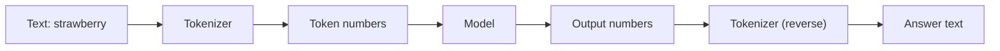
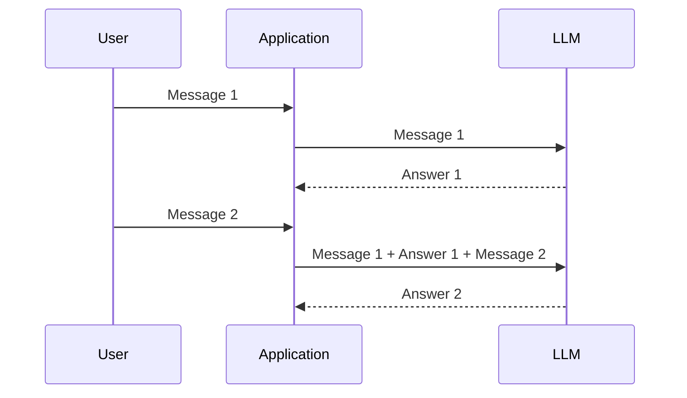

## What a token is {#tokens}

A model doesn't read letters. It reads tokens.

A token is a frequent chunk of text. A word, part of a word, a space followed by a word.

:::pourquoi
Working letter by letter would make very long sequences.
Working word by word would need an endless vocabulary.
The token is the trade-off: a fixed vocabulary, short sequences.
:::

The **tokenizer** does the cutting. It turns each chunk into a number.

The model never sees the text. Only the numbers.

:::pourquoi
That is why it misses “how many r's in strawberry”.
The letter information was erased before it got there.
To count letters, you need a tool that sees letters.
:::

Order of magnitude: in English, 1 token ≈ 4 characters ≈ ¾ of a word.

Most other languages, French among them, take more tokens than English for the same meaning.

:::pourquoi
The vocabulary is learned on a mostly English corpus.
Frequent English words get a token of their own.
Words in other languages are split more often.
:::

The vocabulary can hold tokens that were almost never seen in training. In 2023, researchers find some in GPT-3: “SolidGoldMagikarp” is the best known. These tokens make it go off the rails.

:::pourquoi
The vocabulary and the model didn't learn from the same data.
A token present in one and missing from the other has no learned meaning.
:::

## The context window {#fenetre}

The context window is everything the model sees at once.

It is counted in tokens.

It holds **the prompt and the answer**.

:::pourquoi
The model writes a token, adds it to the context, then writes the next one.
So the answer grows in the same window as the question.
:::

The model has no memory between two calls.

:::pourquoi
Each call stands alone.
The application is what sends the history again.
A chat's “memory” is an application choice, not a property of the model.
:::

If the content is larger than the window, the API returns an error.

:::pourquoi
The API doesn't know what matters to you.
It refuses rather than cut at random.
Deciding what to keep is your job. That is step 1.
:::

## Input, output and cost {#cout}

APIs bill per million tokens. Input and output have two different prices.

An output token costs several times more than an input token.

:::pourquoi
The input is read in a single block, in parallel.
The output is written one token at a time.
Each token written takes a full pass through the model.
:::

The length of the answer drives the latency.

:::pourquoi
Same reasons: the output is sequential.
An answer twice as long takes about twice as long.
:::

A long conversation costs more and more with each turn.

:::pourquoi
The whole history is sent on every call.
It is billed every time.
:::

## Key points

- The model sees token numbers, not letters.
- The window holds the question **and** the answer.
- The model has no memory. The application fakes it.
- Output costs more and drives the latency.
