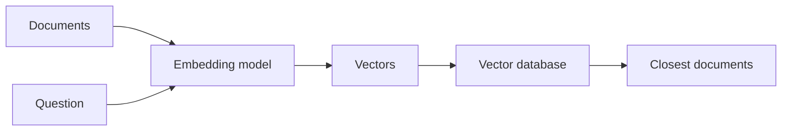

## A text becomes a vector {#vecteur}

An **embedding model** turns a text into a list of numbers.

The list always has the same size, whatever the text.

It is called a **vector**. It is a position in a space of meaning.

:::pourquoi
A computer is bad at comparing sentences.
It is very good at comparing numbers.
The vector makes meaning computable.
:::

Two texts with close meanings have close vectors.

:::pourquoi
The question and the documents go through **the same** model.
Each model has its own space. Two spaces don't compare.
Switching models means recomputing everything.
:::

## Cosine similarity {#cosinus}

To compare two vectors, you measure the angle between them.

Same direction: 1. Unrelated: close to 0.

:::pourquoi
The direction carries the meaning.
The length depends on other things, such as the length of the text.
The cosine ignores the length.
:::

If the vectors are normalized, the cosine is a plain dot product.

:::pourquoi
Less computation, same result.
Over millions of documents, that matters.
:::

A score has no absolute meaning.

:::pourquoi
Each model has its own scale.
A threshold is calibrated on your own examples.
:::

## What an embedding captures, and what it misses {#limites}

It captures the **topic** well. It often misses the **precision**.

It handles these poorly:

- negation: “I like” and “I don't like” are neighbors;
- identifiers: invoice numbers, references, codes;
- rare names and exact figures.

:::pourquoi
The embedding sums up a text as a single position.
What barely changes the topic barely moves the position.
A negation or a number barely changes the topic.
:::

For these cases, you combine it with a keyword search. That is step 2.

The famous “king − man + woman ≈ queen” from 2013 has a small trick. The code excludes the starting words from the possible answers.

:::pourquoi
Without that filter, the answer is often one of the starting words.
Embeddings have real structure. But demos dress it up.
:::

## Key points

- An embedding is a position in a space of meaning.
- The same model for the question and the documents.
- The cosine compares directions. Thresholds are calibrated.
- Good at topic, weak at negation and identifiers.
