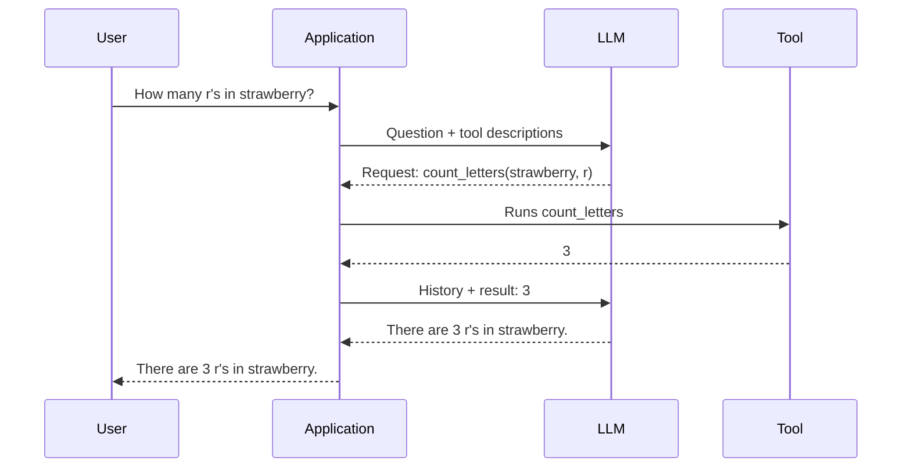

## Describing a tool {#decrire}

The model only produces text. It can't read a file or call an API.

A **tool** lets it ask your application to do those things.

:::pourquoi
That is the answer to the “strawberry” bug.
The model doesn't see letters. A tool does.
The model knows when to ask. The tool knows how to do it.
:::

A tool is described with three things:

- a **name**: `count_letters`;
- a **description**: when to use it, and when not to;
- a **JSON schema** of the parameters: `word` (text), `letter` (one character).

:::pourquoi
The model never sees your code.
It picks the tool from the description alone.
A vague description leads to bad choices.
:::

## The call, result, answer loop {#boucle}

Four actors interact.

1. The application sends the question **and** the list of tools.
2. The model answers with a **tool request**, not with text.
3. The application runs the tool.
4. It sends the result back to the model, with the whole history.
5. The model answers, or asks for another tool.

:::pourquoi
The model has no memory between two calls.
So the application must send back the question, the request and the result.
Otherwise the model no longer knows why it asked for that tool.
:::

The loop stops when the model answers without asking for a tool.

Also set a maximum number of turns.

:::pourquoi
A model can call the same tool over and over.
Each turn costs tokens.
The limit protects your budget.
:::

## What can go wrong {#risques}

**Wrong arguments.** The model can make up a value. Always validate before running.

:::pourquoi
The schema checks the format, not the truth.
A made-up ID has the right format.
:::

**Booby-trapped result.** A tool can return text written by anyone.

:::pourquoi
A web page can contain “ignore your instructions”.
That text is data. Never an instruction.
That is step 6.
:::

**Failed tool.** Send a clear error back to the model.

:::pourquoi
An empty result looks like “no data”.
A clear error lets it retry or warn the user.
:::

## Key points

- The model asks. The application runs.
- The tool's description is all the model sees.
- The loop runs until a final answer, with a limit.
- Validate arguments, treat results as data.
