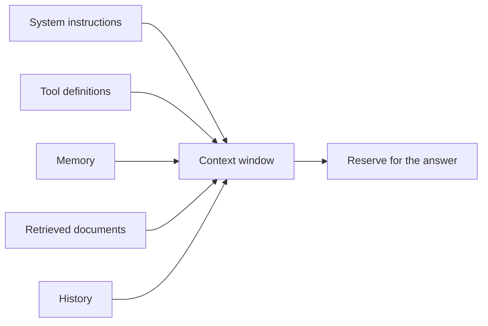

## Splitting the window {#repartir}

The window is shared between several occupants.

Each occupant gets a share. Together, they must not exceed the window.

:::pourquoi
Without a budget, the biggest one wins.
A single huge tool result can push out the whole history.
A budget per occupant keeps the balance.
:::

More context doesn't mean better.

:::pourquoi
In 2025, Chroma tests 18 models.
The longer the input, the less reliable the answers. Even on simple tasks.
Passages that are close but wrong, distractors, make it worse.
:::

Position matters too. The middle is the least well-read zone.

:::pourquoi
The Lost in the Middle study (2023) draws a U-shaped curve.
The start and the end are used well. The middle, less so.
:::

Tools take room. Their definitions are sent again on every call.

:::pourquoi
The model has no memory.
Everything it needs to know, it receives every time.
:::

Measure in tokens, with the model's tokenizer. Not in characters.

:::pourquoi
The “4 characters = 1 token” rule holds for everyday English.
Code, JSON and other languages stray from it.
:::

## Reserving the output {#sortie}

The answer lives in the same window as the prompt.

Reserve its room **before** filling the rest.

:::pourquoi
If the input takes everything, the answer is cut off or refused.
A truncated answer looks like a normal one.
:::

The formula: input + maximum output ≤ window.

Models that think need a larger reserve.

:::pourquoi
Their reasoning is generated text.
It counts as output, before the visible answer.
:::

Your application is what does this computation.

:::pourquoi
Only it knows the input's size and the expected length.
:::

## Key points

- The window is a ceiling, not a target.
- More input, more distractors: less reliability.
- The middle is the least well-read zone.
- Reserve the output first. Count with the model's tokenizer.
