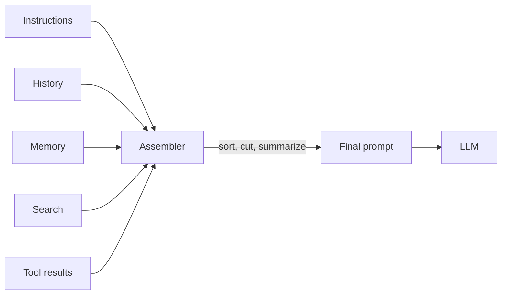

## What to cut first {#couper}

The context is too large. You have to choose.

Rank each piece by priority.

| Priority | Piece | Why |
|---|---|---|
| Never cut | System instructions, current question | Without them, there is no task |
| High | Latest turns, recent tool results | The task at hand depends on them |
| Medium | Relevant documents, useful memory | They help, but can be sorted |
| Low | Old turns, tool results already used | They have already served |

:::pourquoi
A piece is worth what it brings to the next answer.
An old tool result is often large and already summed up by the model itself.
:::

Several sources feed the context. An **assembler** sorts them.

:::pourquoi
Each source knows nothing of the others.
The assembler is the only one that sees the total budget.
It is the one that arbitrates.
:::

Order matters: long documents at the top, the question at the end.

:::pourquoi
The end is well read. The question stays fresh when it is time to answer.
The needle in the haystack showed that presentation changes the result.
:::

## Truncation and summary {#resume}

Two ways to shrink.

**Truncation**: cut. Free, predictable. What is cut is lost.

**Summary**: ask the model to condense. It costs a call. The exact details go.

:::pourquoi
A summary keeps the meaning, not the figures.
“Order 48213, $312.50” becomes “an order”.
Keep IDs, amounts and dates that are still needed word for word.
:::

The two are often combined: summarize old turns, truncate large results.

Cut by whole turns. Never a tool request without its result.

:::pourquoi
APIs check that each result answers a request.
A broken pair makes the history invalid.
:::

## Preventing overflow {#debordement}

Count **before** sending. Not after the error.

Set a threshold, say 80% of the budget. Beyond it, compact.

:::pourquoi
The error lands in front of the user.
The threshold leaves time to summarize cleanly.
:::

Cap the size of each tool result. Say that it is truncated. Give a way to read on.

:::pourquoi
A single huge result can push everything out.
The model knows to ask for another page if told that it can.
:::

In February 2023, Microsoft caps Bing Chat at 5 turns per session.

:::pourquoi
According to Microsoft, very long sessions could confuse the model.
Cutting the session is the simplest prevention.
But the user pays the price.
A good assembler does better: it compacts without erasing everything.
:::

## Key points

- Never cut: instructions and the current question.
- Cut first: old turns and tool results already used.
- Summary for meaning, word for word for exact details.
- Count before sending. Compact at a threshold.
