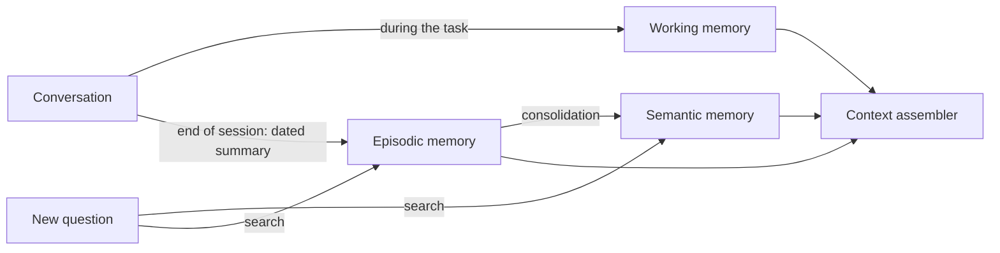

## Three memories

The model has no memory. We build one for it.

We borrow a distinction from psychology: work, episodes, facts.

| Memory | Holds | Example | Lifetime |
|---|---|---|---|
| Working | The state of the task at hand | “Step 3 of 5: rerun the tests” | The task |
| Episodic | What happened | “March 3, order canceled” | Weeks, months |
| Semantic | What is known | “Vegetarian” | Long, revisable |

:::pourquoi
Each memory answers a different question.
Where am I? What happened? What do I know?
Mixing them gives a heap nobody can sort.
:::

The three feed and recall one another.

## Working memory {#travail}

It is the scratchpad of the task at hand: plan, steps done, decisions.

It lives as long as the task.

:::pourquoi
The history ends up cut or summarized.
The plan may vanish with it.
A short scratchpad keeps the state, whatever happens to the history.
:::

## Episodic memory {#episodique}

It keeps events. Dated, compressed.

“March 3: the user cancels order 48213. Reason: delivery too slow.”

:::pourquoi
A raw conversation is thousands of tokens.
A compressed episode is a few dozen.
You can recall many more.
:::

## Semantic memory {#semantique}

It keeps lasting facts. With no date.

“Vegetarian.” “Prefers short answers.” “Works in Rust.”

These facts come from the episodes. That is **consolidation**.

:::pourquoi
A fact drawn from ten episodes is solid.
A fact drawn from one is a hypothesis.
Keep the link to the episodes that justify it.
:::

You don't inject every fact. You search for the ones that serve the question.

:::pourquoi
Injecting everything is costly and drowns the model.
Recalling a memory is a search, just as for a document.
:::

In 2023, MemGPT takes the idea further. The context is RAM. Storage is the disk. The model stores and recalls on its own, with tools.

:::pourquoi
An operating system already moves data between RAM and disk.
MemGPT gives that role to the model.
It decides what must stay in front of it.
:::

## Key points

- Working: where I am. Episodic: what happened. Semantic: what I know.
- Episodes get compressed. Facts get consolidated.
- A fact must keep its sources.
- Recalling is searching. Only what is relevant goes in.
