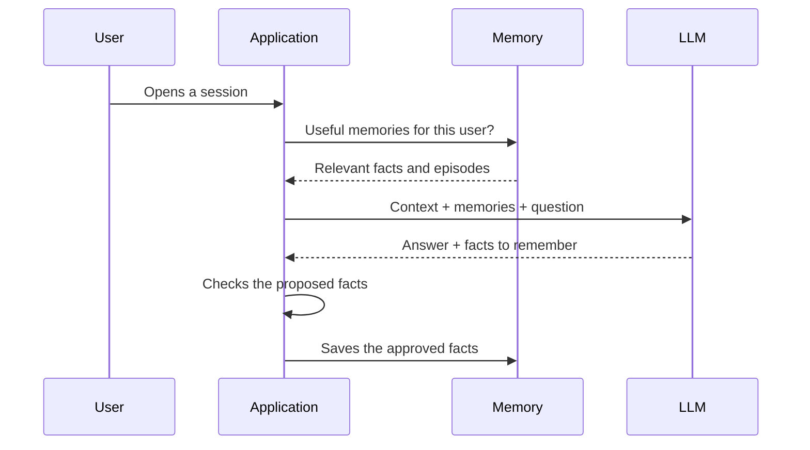

## Importance score {#importance}

Not everything deserves remembering.

In 2023, Stanford builds *Generative Agents*: 25 simulated characters in a small village. Each one has a memory.

Each memory gets an importance rating, from 1 to 10. The model does the rating.

:::pourquoi
A fixed rule doesn't know a breakup matters more than a coffee.
The model understands the meaning.
One rating when the memory is saved, and it is settled for good.
:::

To recall a memory, they combine three scores.

| Score | Question | Computation |
|---|---|---|
| Recency | Used recently? | Decays by 0.5% per game hour |
| Importance | Striking? | The model's rating, from 1 to 10 |
| Relevance | Related to the situation? | Embedding similarity |

:::pourquoi
Relevance alone would bring back last Monday's coffee.
Recency alone would forget the big events.
The three together imitate human memory fairly well.
:::

## TTL and eviction {#ttl}

A memory that only grows becomes a problem.

It costs. It slows the search. It keeps facts that became false.

The **TTL** gives each memory a lifetime.

| Memory | Typical TTL |
|---|---|
| Working | End of the task |
| Episodic | Weeks or months |
| Semantic | Long, but revisable |

:::pourquoi
A task plan is worthless once the task is done.
An episode loses value over time.
A fact stays true until it is contradicted.
:::

A contradicted fact is **replaced**. Not duplicated.

:::pourquoi
“Lives in Lyon” and “lives in Geneva” side by side: the model may pick the wrong one.
Update the fact. The episode of the move keeps the history.
:::

When space runs short, **evict** the memories with the lowest combined score.

## Persistence across sessions {#persistance}

A persistent memory outlives the end of the session.

It is stored outside the model: a database, files.

:::pourquoi
The model proposes. The application decides what enters memory.
A false memory comes back in every session.
:::

In September 2024, Johann Rehberger shows the *SpAIware* attack on ChatGPT. A booby-trapped page gets an instruction saved to memory. It comes back in every conversation that follows.

:::pourquoi
Memory makes an attack permanent.
What comes from a page, an email or a tool is data.
It doesn't enter memory unchecked.
:::

One memory per user. Always isolated.

:::pourquoi
A memory that leaks to someone else is a personal data leak.
Each search filters by owner.
:::

Erasure must be possible, everywhere.

:::pourquoi
The GDPR grants a right to erasure.
Memories about a person are personal data.
:::

## Key points

- Recall by three criteria: recency, importance, relevance.
- Each memory has its lifetime. A contradicted fact is replaced.
- The model proposes memories. The application checks them.
- Memory isolated per user, and erasable.
