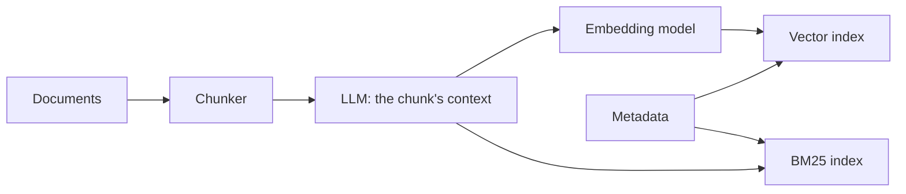

## Chunking {#decoupage}

You don't search in documents. You search in **chunks**.

:::pourquoi
One vector for a long document averages its topics.
It no longer resembles any precise question.
A chunk carries one idea. It can be found and injected.
:::

Size is a trade-off.

| Too small | Too large |
|---|---|
| Loses its context | Mixes several ideas |
| “It grew by 3%”: who did? | Wastes the token budget |

Cut at natural boundaries: headings, paragraphs, functions. Never cut a table.

:::pourquoi
The author already structured the text by ideas.
A table without its headers no longer makes sense.
:::

Add **overlap**: a few sentences repeated from one chunk to the next.

:::pourquoi
A cut can fall in the middle of an explanation.
Overlap keeps the whole idea in at least one chunk.
:::

In 2024, Anthropic publishes **Contextual Retrieval**. An LLM writes 50 to 100 tokens of context for each chunk. They are prepended before indexing.

| Method | Failures in the top 20 |
|---|---|
| Baseline | 5.7% |
| + context, embeddings | 3.7% |
| + context, embeddings and BM25 | 2.9% |
| + reranking | 1.9% |

:::pourquoi
“Revenue grew by 3% over the previous quarter” becomes “ACME, Q2 2023: revenue grew by 3% over the previous quarter”.
The chunk can be found again.
These are Anthropic's figures, on its own data. On yours, they will differ.
:::

## Metadata {#metadonnees}

Each chunk carries a record: source, date, author, type, language, version, access rights.

:::pourquoi
The text doesn't say everything.
A joke and a piece of advice look alike. Only the source tells them apart.
That is what Google had to add after the glue on pizza.
:::

Access rights are filtered **during** the search.

:::pourquoi
A retrieved document is read by the model.
An instruction like “don't reveal it” can be bypassed.
The only safe filter: it is never retrieved.
:::

Filter before or during the search. Not after.

:::pourquoi
The filter may remove all of the top 10 results.
Then nothing is left, although good documents existed.
:::

## Indexing {#indexation}

Each chunk goes into two indexes.

The vector index uses an **approximate** search, often HNSW.

:::pourquoi
Comparing the question with millions of vectors one by one is too slow.
HNSW jumps from neighbor to neighbor toward the right area.
It sometimes misses a neighbor. That is the price of speed.
:::

Store with each chunk: its text, the document's ID, its position, its metadata.

:::pourquoi
Text to inject it. ID to cite and update.
Position to read the neighbors. Metadata to filter.
:::

A document changes: replace **all** its chunks.

:::pourquoi
A forgotten old chunk can still be found.
The model will quote an outdated price, with full confidence.
:::

## Key points

- Chunks that carry one idea, cut along the structure.
- A chunk without context can't be found. Add it.
- Metadata filters what the text doesn't say, access rights included.
- On update: replace every chunk of the document.
