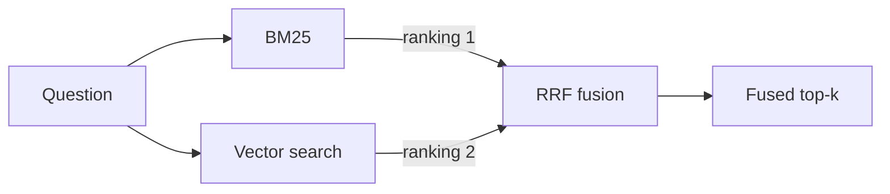

## BM25 {#bm25}

BM25 searches by **words**. It is the heir of 1990s search engines.

It favors three things:

- words that are **rare** in the corpus (they discriminate);
- words **present** in the document, with an effect that saturates;
- **short** documents, all else being equal.

:::pourquoi
A word present everywhere distinguishes nothing.
Repeating a word 50 times doesn't make a text 50 times more relevant.
A long document contains many words by chance.
:::

Strong at: IDs, codes, proper names, technical terms.

Weak at: synonyms, rephrasings, other languages.

:::pourquoi
BM25 compares words, not ideas.
“cancel” and “terminate” share no word.
:::

Configure a language analyzer for your corpus's language.

:::pourquoi
Without it, “mice” and “mouse” are two unrelated words.
The analyzer brings words back to their root and handles accents.
:::

## Vector search {#vectorielle}

Encode the question. Look for the chunks whose vector is closest.

Strong at: synonyms, rephrasings, multilingual search.

Weak at: IDs, negation, domains the model doesn't know.

:::pourquoi
The embedding captures the general meaning.
An invoice number has no “meaning”.
A model trained on general web text knows your business jargon poorly.
:::

In 2021, the BEIR benchmark tests models on 18 datasets. BM25 remains a solid baseline. Several vector models do worse outside their domain.

:::pourquoi
A model trained on one domain loses its footing on another.
BM25 learned nothing, so it has nothing to forget.
Measure on your data before choosing.
:::

Follow the model's instructions: some want one prefix for the question and another for the document.

:::pourquoi
A short question doesn't look like a long passage.
The prefix tells the model which role each text plays.
Forgetting it degrades results silently.
:::

## Hybrid fusion (RRF) {#hybride}

Run both searches. Fuse their rankings.

:::pourquoi
They fail differently.
What one misses, the other often finds.
:::

Fuse the **ranks**, not the scores.

:::pourquoi
A BM25 score has no fixed scale. A cosine stays between -1 and 1.
Adding them would give BM25 all the power.
:::

**RRF** (Reciprocal Rank Fusion, 2009): each document earns 1/(k + rank) in each list. Add them up. k is often 60.

| Document | BM25 rank | Vector rank | RRF score |
|---|---|---|---|
| A | 1 | absent | 1/61 ≈ 0.0164 |
| B | 2 | 2 | 2 × 1/62 ≈ 0.0323 |

:::pourquoi
A document ranked well by both searches is a safe bet.
RRF rewards that agreement.
k = 60 dampens the gap between the 1st and 2nd ranks.
:::

## Key points

- BM25: exact words, IDs. Misses synonyms.
- Vector: meaning, synonyms. Misses IDs and unknown domains.
- Hybrid: fuse the ranks with RRF.
- Measure on your data before ruling out BM25.
