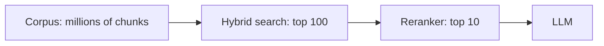

## Bi-encoder and cross-encoder {#encodeurs}

Two ways to measure whether a document answers a question.

| | Bi-encoder | Cross-encoder |
|---|---|---|
| Reading | Question and document separately | Question and document together |
| Precomputing | Yes, at indexing time | Impossible |
| Speed | Very fast | Slow |
| Precision | Good | Better |
| Use | First search | Second sort |

:::pourquoi
The bi-encoder sums up each text alone, as a vector.
The cross-encoder sees both texts side by side.
It notices that a document is on the right topic without answering the question.
:::

In 2019, Nogueira and Cho apply BERT as a cross-encoder to re-sort passages. The gain is clear on the MS MARCO benchmark.

:::pourquoi
That is when neural reranking becomes the norm.
The idea hasn't changed since: a finer second sort on few candidates.
:::

**ColBERT** (2020) is a trade-off: one vector per token, precomputed, compared token by token.

:::pourquoi
More detail than one vector per text.
Precomputable, unlike the cross-encoder.
The price: much more storage.
:::

## Latency versus precision {#compromis}

Search is organized as a **funnel**.

Stage 1: wide and fast. It aims for **recall**: miss nothing.

Stage 2: narrow and slow. It aims for **precision**: sort well.

:::pourquoi
The reranker sorts. It doesn't search.
A document missing from the candidates is lost for good.
:::

The number of candidates is the main setting.

:::pourquoi
More candidates, more chances of having the right one.
But the reranker makes one pass per candidate.
Four times the candidates, about four times the reranking time.
:::

Watch the p95 latency, not the average.

:::pourquoi
The average hides slow requests.
The p95 tells what the hard cases go through.
:::

## Key points

- Bi-encoder: fast, precomputed, for searching.
- Cross-encoder: precise, costly, for re-sorting.
- Funnel: recall first, precision next.
- The reranker never recovers a missing document.
