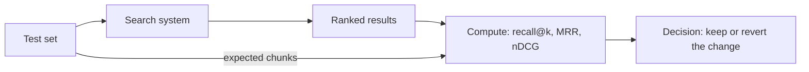

## recall@k, MRR, nDCG {#metriques}

Without measurement, you tune blind.

Three measures, three questions.

| Measure | Question | Use |
|---|---|---|
| recall@k | Are the right documents in the top k? | First stage of a RAG system |
| MRR | At what rank does the first right document come? | A single right answer |
| nDCG | Are the most relevant at the very top? | Graded relevance |

**recall@k**: relevant documents found in the top k, divided by relevant documents that exist.

:::pourquoi
The LLM only sees the k chunks it is given.
What sits at rank k+1 doesn't exist for it.
Anthropic measures Contextual Retrieval as failures in the top 20: 1 minus recall@20.
:::

**MRR**: the average of 1/rank of the first good result.

:::pourquoi
Rank 1 is worth 1. Rank 2 is worth 0.5. Rank 10 is worth 0.1.
It punishes hard a good result that doesn't come first.
:::

**nDCG**: each document has a relevance grade. Its gain shrinks with the rank. Divide by the score of a perfect order.

:::pourquoi
Some documents are very relevant, others somewhat.
nDCG rewards the best ones placed at the top.
1 means a perfect order.
:::

## Building a test set {#jeu-de-test}

A test set: questions, and for each one, the chunks that answer it.

:::pourquoi
To measure what you missed, you need to know what should have been found.
:::

Where do the questions come from?

- Real users: the best, but they need labeling.
- Generated by an LLM from the chunks: fast, but too easy.

:::pourquoi
An LLM reading a chunk reuses its words.
Keyword search finds them too well.
The score becomes flattering.
:::

Cover the hard cases:

- IDs and codes;
- synonyms and rephrasings;
- answers spread over several documents;
- questions with **no** answer in the corpus.

:::pourquoi
Each case tests a different weakness.
A set of easy cases shows 95% and teaches you nothing.
:::

Start small: 50 to 100 questions. Grow it with real failures.

Keep part of the set aside. Never tune on it.

:::pourquoi
Tuning again and again on the same questions optimizes for them.
The part set aside tells whether the gain is real.
:::

Run the measurement again on every change: chunking, model, filters, reranker.

## Key points

- recall@k for the first stage. MRR or nDCG for the order.
- A test set: questions and expected chunks.
- LLM-generated questions: too easy on their own.
- Part of the set kept aside, never used for tuning.
