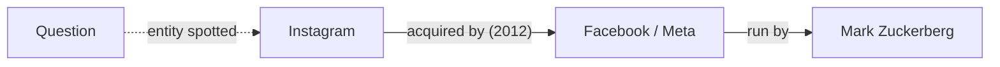
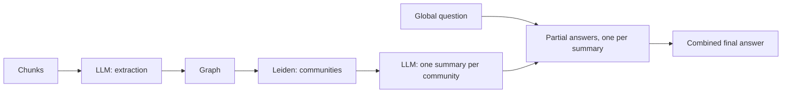

## Entities and relations {#entites}

Classic RAG stores isolated chunks. GraphRAG also stores **the links** between them.

An LLM reads each chunk and extracts:

- **entities**: people, organizations, places, products;
- **relations**: “Facebook — acquired — Instagram”.

:::pourquoi
A vector index can say “this chunk looks like the question”.
It can't say “this chunk is linked to that one”.
The graph keeps that link.
:::

The hardest part: recognizing that one actor goes by several names.

:::pourquoi
“Mr. Smith”, “John Smith”, “the CEO”: three nodes instead of one.
The relations scatter, the traversal misses links.
That is entity resolution.
:::

## Multi-hop traversal {#multi-sauts}

Some questions require linking two facts.

“Who runs the company that acquired Instagram?”

:::pourquoi
The chunk about the acquisition looks like the question.
The chunk about the CEO doesn't.
Vector search finds the first and misses the second.
The graph follows the edge and finds both.
:::

Limit the traversal to 1 or 2 hops.

:::pourquoi
With each hop, the number of neighbors multiplies.
Beyond that, the context fills with distant links.
:::

## Community summaries {#communautes}

In 2024, Microsoft publishes GraphRAG for another family of questions: **global** questions.

“What are the main themes of this corpus?”

:::pourquoi
No passage contains the answer.
It takes an overall view.
Vector RAG has nothing similar to retrieve.
:::

The method:

:::pourquoi
A community is a group of closely linked entities: often a theme.
Summarizing each theme in advance prepares the overall view.
At question time, the summaries are combined instead of rereading the corpus.
:::

## When it isn't worth the cost {#cout}

GraphRAG is expensive to build.

:::pourquoi
One LLM call per chunk to extract.
One call per community to summarize.
Everything must be redone when the corpus changes a lot.
:::

Microsoft admits it. In November 2024, it publishes **LazyGraphRAG**: indexing at the same cost as vector RAG, that is 0.1% of GraphRAG's.

:::pourquoi
LazyGraphRAG summarizes nothing in advance.
It puts the LLM to work at question time.
The cost moves from indexing to the query.
:::

Decision rule:

| Kind of question | Example | Tool |
|---|---|---|
| Local | “How do I change my password?” | Hybrid RAG + reranking |
| Multi-hop | “Who runs the company that acquired X?” | Graph, 1 to 2 hops |
| Global | “What are the main themes?” | Community summaries |

:::pourquoi
According to Microsoft, vector RAG excels when the answer looks like the question.
Start with it. Measure.
Add a graph only if multi-hop or global questions fail.
:::

## Key points

- A graph stores the links that vectors ignore.
- Multi-hop: follow the relations, 1 or 2 hops.
- Global questions: community summaries, combined.
- High indexing cost. Start simple, add a graph if measurement justifies it.
