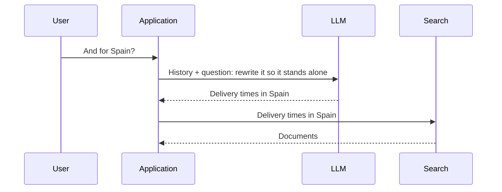
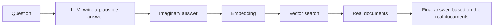

## Rewriting {#reformulation}

The user's question isn't always a good search query.

It depends on the history. It uses their words, not the documents' words.

:::pourquoi
The search doesn't see the history.
“And for Spain?” alone finds nothing useful.
:::

You can generate several rewrites and fuse the results.

:::pourquoi
Each wording catches other documents.
You cover more vocabulary.
The price: several searches.
:::

Expand acronyms. Keep the short form too.

:::pourquoi
The document may use either one.
BM25 doesn't make the link on its own.
:::

## Decomposition {#decomposition}

A complex question hides several simple ones.

“Compare 2023 and 2024” → “Rules in 2023?” + “Rules in 2024?”

:::pourquoi
A single search favors one of the two topics.
One search per sub-question finds each piece.
:::

In 2022, Self-Ask measures a **compositionality gap**: the model answers the sub-questions, but misses the combined question.

:::pourquoi
Combining two facts silently is hard.
Writing out the steps makes each fact explicit.
:::

Don't split simple questions.

:::pourquoi
Each sub-question costs a call and a search.
:::

## HyDE {#hyde}

HyDE (2022) flips the problem. You don't search with the question. You search with an **imagined answer**.

:::pourquoi
A question doesn't look like an answer paragraph.
An imagined answer does.
Even when wrong, it has the right vocabulary and shape.
:::

The imaginary answer is **never** shown.

:::pourquoi
It is written without a source.
It is a probe, not an answer.
:::

## Key points

- Rewrite the question so it stands on its own.
- Several wordings, results fused.
- Split compound questions, not simple ones.
- HyDE: search with an imagined answer, never show it.
