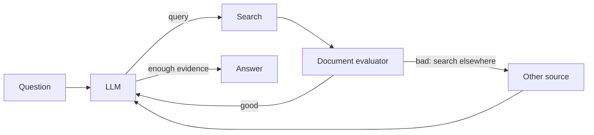

## Looping {#boucler}

Simple RAG does: search, then answer. Once.

Multi-step RAG does: search, read, decide, search again.

:::pourquoi
What you read changes what you need to search for.
The first document often reveals the name to search for next.
:::

Several families of approaches:

| Approach | Idea |
|---|---|
| IRCoT (2022) | Alternate a reasoning step and a search |
| Self-RAG (2023) | The model decides whether to search, and judges whether it is supported |
| CRAG (2024) | An evaluator grades the documents, and searches elsewhere if they are bad |
| Agentic RAG | Search is a tool the model calls freely |

:::pourquoi
All share one idea: search is no longer a fixed step.
It becomes a decision made along the way.
:::

## Knowing when to stop {#arreter}

An endless loop costs a lot. And it doesn't improve the answer.

Stop when:

- each part of the question has evidence;
- **or** the maximum number of turns is reached;
- **or** searches bring back nothing new.

:::pourquoi
The model can always find a reason to search again.
The limit protects the budget and the response time.
Identical results signal you are going in circles.
:::

Don't keep everything the steps brought back.

:::pourquoi
Each step adds passages.
Duplicates and distractors lower the quality.
Deduplicate. Keep what serves the answer.
:::

If the loop stops without enough evidence, don't guess. Abstain.

:::pourquoi
A loop that fails is useful information.
It says the corpus doesn't hold the answer.
That is the subject of the Abstention topic.
:::

## Key points

- What you read tells you what to search for next.
- Search becomes a decision, made by the model or by an evaluator.
- Stop: complete evidence, maximum turns, or nothing new.
- No evidence at the end: abstain.
