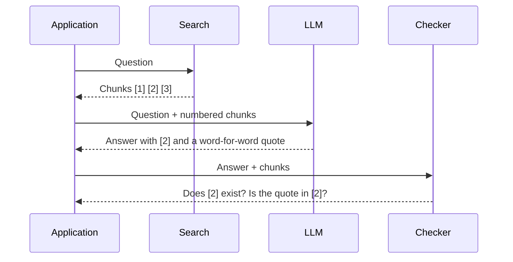

## Citing sources {#citer}

An answer without a source can't be checked.

Spring 2023. In *Mata v. Avianca*, a New York lawyer files a brief. It cites case law found with ChatGPT.

None of it exists.

He had even asked ChatGPT whether the cases were real. ChatGPT said yes.

:::pourquoi
The model produces likely text.
“Yes, this case exists” is a likely answer.
The judge sanctions the lawyers. The fault was not checking.
:::

The citation must be checkable **by your code**, not by the model.

:::pourquoi
The IDs come from your application. The model can't make up valid ones.
A word-for-word quote is checked with a plain text search.
:::

For a long document, ask for the exact passages first, then the analysis.

:::pourquoi
It is a recommendation from Anthropic.
Extracting first forces the model to rely on the real text.
If it finds nothing, it says so instead of making things up.
:::

## Checking support {#support}

Citing isn't enough. Air Canada's chatbot cited the right page. The page said the opposite.

:::pourquoi
The citation says where the claim comes from.
It doesn't say whether the source supports it.
:::

In 2024, Stanford tests RAG-based legal tools. Some are marketed as “hallucination-free”. They are wrong in more than one query in six.

:::pourquoi
RAG reduces hallucinations, it doesn't eliminate them.
The model can misread, miscombine, or fill in from memory.
You must check the output, not just the input.
:::

The method: split the answer into claims, then judge each one.

A made-up example, an online shop:

| Claim | Source | Verdict |
|---|---|---|
| “Free returns within 60 days” | Terms of sale: “free returns within 30 days” | Contradicted |
| “Refunds go to the original payment method” | Terms of sale, section 7 | Supported |
| “Sale items can't be returned” | None | Absent |

:::pourquoi
An overall answer mixes true and false.
A verdict per claim shows exactly what is wrong.
What isn't supported is removed or flagged.
:::

**Faithfulness** is the share of claims supported by the context.

:::pourquoi
It doesn't judge the truth of the world. It judges the link to the sources.
A true answer with no source isn't faithful.
:::

## Key points

- The model doesn't check its own citations.
- IDs provided by the application, word-for-word quotes checked by code.
- Citing isn't supporting. Judge each claim.
- RAG reduces hallucinations. It doesn't eliminate them.
