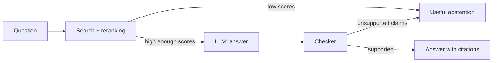

## Confidence thresholds {#seuils}

Sometimes, the right answer is not to answer.

But that must be decided on **signals**, not on a hunch.

| Signal | What it indicates |
|---|---|
| Best document's score | Does the corpus hold the answer? |
| Reranker's score | Do the passages really answer? |
| Checker's verdict | Is the answer supported? |
| Consistency across several answers | Is the model stable? (next topic) |

:::pourquoi
No signal is perfect on its own.
Together, they say whether the answer rests on solid ground.
:::

Confidence expressed in words (“95% sure”) is often poorly calibrated.

:::pourquoi
It is generated text, not a measurement.
Prefer computed scores, and check them on your test set.
:::

The threshold is tuned on **unanswerable** questions, and by the cost of an error.

:::pourquoi
Too low: you answer everything and get it wrong.
Too high: you no longer answer anything.
In medicine, you accept more abstentions than in cooking.
:::

## Saying “I don't know” {#je-ne-sais-pas}

September 2025. OpenAI publishes *Why language models hallucinate*.

Its thesis: models are trained and scored like students taking an exam with no negative marking.

:::pourquoi
Guessing a birthday: a one-in-365 chance to score.
“I don't know”: zero, always.
A model optimized for those scores learns to guess.
:::

The article compares two models. One abstains on 52% of questions. The other on 1%. The second has slightly better accuracy. But far more errors.

:::pourquoi
Answering everything gains a few right answers.
And piles up wrong ones.
Never measure accuracy without counting errors.
:::

Explicitly allow abstention in the prompt.

:::pourquoi
Anthropic presents it as the basic technique against made-up answers.
Without permission, the model tries to answer at all costs.
:::

A good abstention still helps:

- what is certain, with its source;
- what is missing;
- a next step: a link, a human, a clarifying question.

:::pourquoi
Air Canada's chatbot had the official page at hand.
It could have said: “I'm not sure. Here is the official page on bereavement fares.”
A less appealing answer. But not a made-up rule.
:::

## Key points

- Abstain on measured signals, not on a hunch.
- The threshold is tuned on unanswerable questions, by the cost of an error.
- Evaluations that ignore errors push models to guess.
- Allow “I don't know”, and make it useful.
