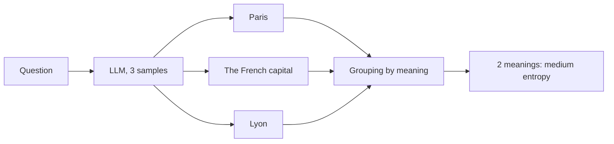
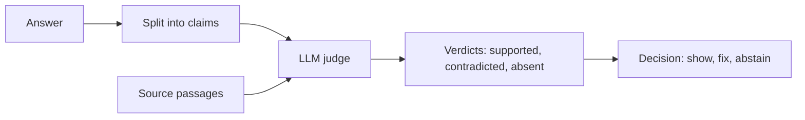

## Consistency {#coherence}

A simple idea: ask the same question several times.

A known fact comes back. A made-up fact changes.

:::pourquoi
When the model knows, the most likely answer dominates.
When it improvises, several answers are equally likely, and the sample varies.
:::

**SelfCheckGPT** (2023) compares several samples with one another. No external source needed.

**Semantic entropy** (Nature, 2024) groups the samples **by meaning**. Many different meanings: a risk of making things up.

:::pourquoi
“Paris” and “the French capital” say the same thing.
Counting different texts would inflate the uncertainty.
Counting different meanings measures the real hesitation.
:::

Limit: a learned error is repeated consistently.

:::pourquoi
All samples agree, and all are wrong.
Consistency detects improvisation, not learned errors.
:::

Cost: several generations per question.

## Judge {#juge}

A second model checks the answer against the sources.

:::pourquoi
Comparing a claim with a passage is a simple task.
Much simpler than producing the answer.
A smaller model can often do it.
:::

**FActScore** (2023) formalizes the idea: atomic facts, checked one by one.

:::pourquoi
An overall score hides an isolated error.
A verdict per fact shows it.
:::

The judge must receive the sources.

:::pourquoi
Without them, it checks from memory.
It may hallucinate in turn.
:::

The judge makes mistakes too. Measure its agreement with humans.

:::pourquoi
An uncalibrated judge gives a false sense of security.
That is the topic of step 7.
:::

Where do you place the check?

| Case | Strategy |
|---|---|
| Risky topic: health, law, money | Check before showing |
| Everyday question | Show, check a sample afterwards |

## Key points

- Consistency: a fact that varies between samples is suspect.
- Compare meanings, not words.
- Consistency misses learned errors. The judge with sources catches them.
- The judge is calibrated against humans.
