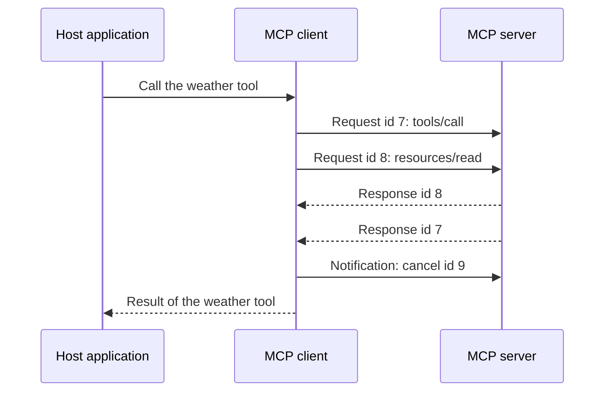

## Request and response {#requete}

MCP speaks **JSON-RPC 2.0**. A simple format to call a function remotely.

```json
{ "jsonrpc": "2.0", "id": 7, "method": "tools/call",
  "params": { "name": "weather", "arguments": { "city": "Lyon" } } }
```

```json
{ "jsonrpc": "2.0", "id": 7, "result": { "content": [ { "type": "text", "text": "12 °C" } ] } }
```

The same id in the request and the response.

:::pourquoi
Several requests can be in flight at once.
Responses can come back out of order.
The id says which request each response answers.
:::

A response contains `result` **or** `error`. Never both.

MCP adds two rules: the id is never `null`, and it is unique among requests in progress.

:::pourquoi
A null or reused id would make the match ambiguous.
:::

JSON-RPC says nothing about the transport.

:::pourquoi
It describes the messages, not the pipe.
So MCP can go through standard input or through HTTP.
:::

## Notification {#notification}

A notification is a message **with no id**. Nobody responds to it.

```json
{ "jsonrpc": "2.0", "method": "notifications/tools/list_changed" }
```

:::pourquoi
Some messages inform without asking for anything.
“The tool list has changed.” “Cancel request 7.”
Waiting for a response would be pointless.
:::

## Errors {#erreurs}

JSON-RPC's standard codes:

| Code | Meaning | Example |
|---|---|---|
| -32700 | Parse error | Unreadable JSON |
| -32600 | Invalid request | `method` is missing |
| -32601 | Method not found | `tools/cal` instead of `tools/call` |
| -32602 | Invalid params | Unknown tool, missing argument |
| -32603 | Internal error | Exception on the server |

MCP reserves its own codes, for example -32022 for an unsupported protocol version.

:::pourquoi
An integer code can be tested in the program.
A free-text message can't be tested reliably.
:::

Never put a secret in `message` or `data`.

:::pourquoi
The error goes back to the client, and often to the model.
A file path or a key in an error is a leak.
:::



## Key points

- Request: id, method, params. Response: same id, result or error.
- Notification: no id, no response.
- Error codes are testable. Messages carry no secrets.
- JSON-RPC describes the messages, not the transport.
