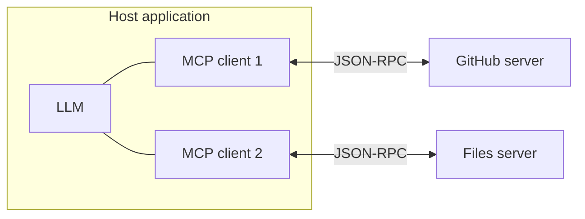
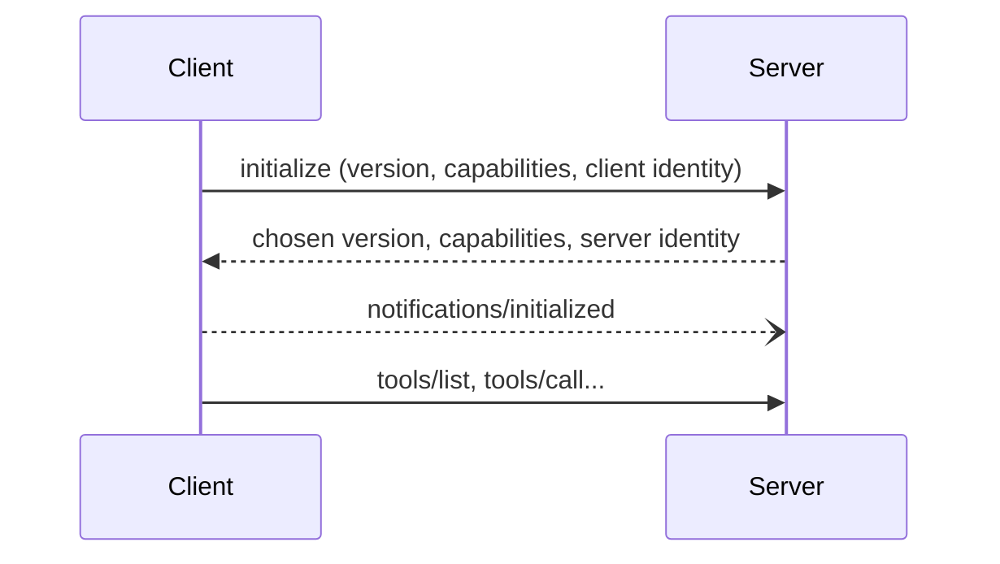

## Why a protocol {#versions}

November 2024. Anthropic publishes the **Model Context Protocol**.

The problem: every AI application coded its own connectors to every tool.

:::pourquoi
10 applications, 20 tools: 200 integrations.
With a common protocol: 10 clients and 20 servers.
Every new server works with every application.
:::

In December 2025, Anthropic donates MCP to the Agentic AI Foundation, under the Linux Foundation. Anthropic, Block and OpenAI co-found it.

:::pourquoi
A standard backed by a single player worries its competitors.
A neutral foundation reassures those who adopt it.
:::

Three roles:

| Role | Example | Does what |
|---|---|---|
| Host | Claude Desktop, an IDE | Holds the model and the interface |
| Client | One per server, inside the host | Speaks the protocol |
| Server | GitHub, files, a database | Exposes tools, resources, prompts |

### Versions evolve

Up to revision **2025-11-25**, a connection starts with a handshake.

:::pourquoi
Both sides agree on the version and the features available.
If the client doesn't support the proposed version, it disconnects.
Before that agreement, only pings are allowed.
:::

Revision **2026-07-28** removes this handshake. The protocol becomes **stateless**.

Each request carries its version and the client's capabilities in `_meta`. An unsupported version returns error -32022, with the list of accepted versions.

:::pourquoi
Without a session, any instance of the server handles any request.
A load balancer can send it wherever it likes.
A restart breaks nothing.
Needed state goes through explicit IDs: a cart number, a transaction number.
:::

Many servers still speak the old version. A client can speak both.

## tools/list and tools/call {#outils}

`tools/list`: the client discovers the tools.

`tools/call`: the client calls one, with its arguments.

The result contains `content` (text, image…), optionally `structuredContent` validated by the output schema, and `isError`.

Two kinds of errors:

| Error | Example | Form | Goes to the model? |
|---|---|---|---|
| Protocol | Unknown tool, malformed request | JSON-RPC error | Rarely useful |
| Execution | Date in the past, API unavailable | Result with `isError: true` | Yes, so it can correct itself |

:::pourquoi
“The date must be in the future” is actionable information.
The model can fix the argument and try again.
A protocol error signals a bug in the client, not a model mistake.
:::

**Annotations** (`readOnlyHint`, `destructiveHint`…) are hints. Not guarantees.

:::pourquoi
The server declares them.
A malicious server can lie.
The specification requires treating them as untrusted, unless the server is trusted.
:::

Return the tools in a stable order.

:::pourquoi
The tool list goes into the prompt.
A stable order lets the prompt cache reuse it.
:::

## Resources and prompts {#ressources}

MCP has three primitives. Each has its decider.

| Primitive | Who decides | Example |
|---|---|---|
| Tool | The model | Create a GitHub issue |
| Resource | The application | The project's README file |
| Prompt | The user | The /code-review command |

:::pourquoi
The model shouldn't decide everything.
The application picks the context. The user picks the task template.
The model acts within that frame.
:::

A **resource** is identified by a URI. You list it, read it, and can subscribe to its changes.

A **prompt** is a template of messages, with arguments. It often shows up as a slash command.

A file server must prevent directory traversal.

:::pourquoi
“../../.ssh/id_rsa” leaves the allowed folder.
The specification explicitly forbids it.
:::

## stdio and HTTP {#transports}

Two standard transports.

**stdio**: the client launches the server as a subprocess. They talk through standard input and output.

- One JSON message per line. No newline inside.
- `stdout`: MCP messages only.
- `stderr`: the logs.
- Shutdown: the client closes standard input, waits, then forces the stop if needed.

:::pourquoi
The client reads stdout line by line.
A single debug print() there breaks communication.
It is the number-one bug of first servers.
:::

**Streamable HTTP**: the server is a web service, with a single endpoint. It can stream its responses (SSE). It replaces the older HTTP+SSE transport from 2024.

Locally, the specification requires checking the `Origin` header, and recommends listening on 127.0.0.1 and authenticating.

:::pourquoi
A web page can target a local server through DNS rebinding.
Checking Origin blocks the attack.
Listening on 0.0.0.0 exposes the server to the whole network.
:::

Credentials: over HTTP, MCP's OAuth authorization framework. Over stdio, the environment.

## Key points

- MCP turns N × M integrations into N + M.
- Up to 2025-11-25: the initialize handshake. Since 2026-07-28: stateless, version in every request.
- Execution error: `isError`, so the model can correct itself. Protocol error: JSON-RPC.
- Annotations untrusted. stdout reserved for messages. Origin checked over HTTP.
