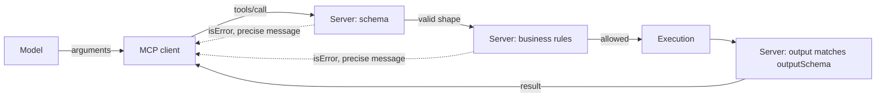

## JSON Schema {#json-schema}

An MCP tool describes its arguments with **JSON Schema**. By default, version 2020-12.

```json
{
  "type": "object",
  "properties": {
    "departure_date": { "type": "string", "format": "date",
                        "description": "Departure date, YYYY-MM-DD, in the future" },
    "priority": { "type": "string", "enum": ["low", "normal", "high"] },
    "passengers": { "type": "integer", "minimum": 1, "maximum": 9 }
  },
  "required": ["departure_date", "passengers"],
  "additionalProperties": false
}
```

The keywords that matter:

| Keyword | Role |
|---|---|
| `required` | Required fields |
| `enum` | Closed list of values |
| `minimum`, `maximum`, `pattern` | Bounds and format |
| `additionalProperties: false` | Rejects any undeclared field |
| `description` | What the model reads to fill the field |

:::pourquoi
A schema serves two readers.
The model reads it to know what to write.
The validator reads it to reject what is wrong.
:::

A tool with no parameters: `{"type": "object", "additionalProperties": false}`.

:::pourquoi
The specification recommends it.
It only accepts an empty object.
:::

Never resolve a remote `$ref` automatically.

:::pourquoi
It would be a network request triggered by a schema.
A booby-trapped schema could target an internal service.
:::

With **Pydantic**, a Python class produces the schema (`model_json_schema()`) and validates the arguments. `extra="forbid"` gives `additionalProperties: false`.

:::pourquoi
A single definition to describe and to validate.
They can no longer drift apart.
:::

## Validating inputs and outputs {#valider}

The server **always** validates its inputs. Even if the client already did.



:::pourquoi
The server doesn't control its clients.
The specification requires it to validate everything that comes in.
:::

Two layers:

1. **The schema**: types, fields, bounds.
2. **The business rules**: date in the future, resource owned by the user, amount under the cap.

:::pourquoi
A schema knows neither today's date nor the user's rights.
These rules live in code.
:::

On error, return a message the model can act on: the field, the value, the rule, an example.

:::pourquoi
The model corrects itself with what it is told.
“Error” teaches it nothing.
:::

Validate the output too. The server follows its `outputSchema`. The client checks.

:::pourquoi
A malformed output breaks the code that reads it.
Catching it at the boundary avoids a later error that is harder to understand.
:::

An LLM API's strict mode doesn't replace server validation.

:::pourquoi
It protects one client. The server has others.
And it doesn't check business rules.
:::

## Key points

- Strict schema: `required`, `enum`, bounds, `additionalProperties: false`.
- The model reads the descriptions. Take care over them.
- The server always validates: schema, then business rules.
- Precise error messages. Outputs validated too.
