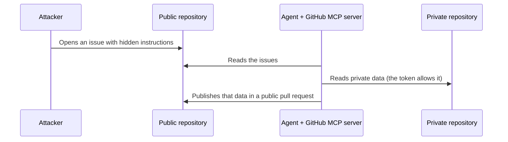
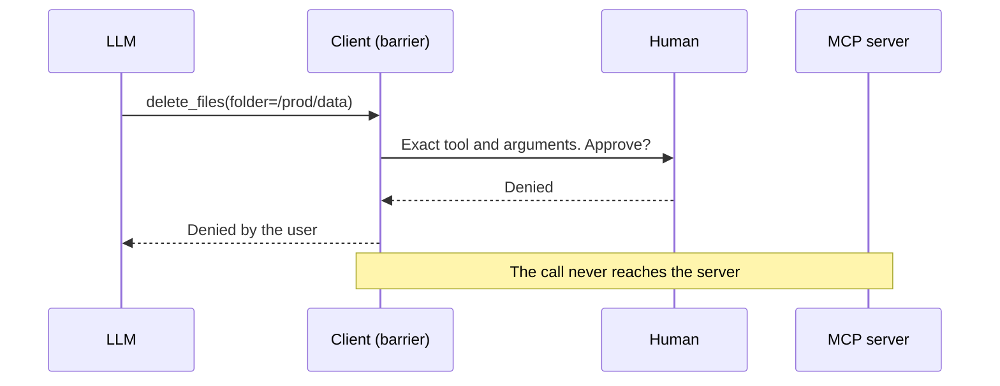

## Tool scope {#portee}

Each tool grants a power. Grant only the power needed.

May 2025. Invariant Labs shows an attack on GitHub's official MCP server.

:::pourquoi
The server had no bug in the classic sense.
The problem: a token that opened every repository, and an agent that read public content.
Invariant recommends one repository per session and fine-grained rights.
:::

Simon Willison names the general pattern the **lethal trifecta**: private data, untrusted content, external communication.

:::pourquoi
Untrusted content carries the order. Private data is the target. External output is how it is stolen.
Remove just one of the three, and the attack fails.
:::

Rules:

- a read-only token if the agent only reads;
- limited to one project, one folder, one repository;
- precise tools rather than one tool that does everything.

:::pourquoi
`run_sql` can also do `DROP TABLE`.
`read_order` can only read an order.
The rights are enforced by the service. The model can't get around them.
:::

## Sandbox {#sandbox}

A tool that runs code or commands runs in a **sandbox**.

| Limit | Why |
|---|---|
| Container or VM | No access to your files |
| No secrets in the environment | Nothing to steal |
| Network off or allowlisted | Nothing to send out |
| Bounded time, memory, disk | An infinite loop blocks nothing |
| Only the working folder writable | No changes elsewhere |

:::pourquoi
Generated code can be wrong.
It can also be dictated by an injection.
Isolation limits the damage in both cases.
:::

Separate development and production.

:::pourquoi
At Replit, the same database served testing and production.
An agent mistake in development wiped production.
:::

A stdio MCP server runs with **your** rights.

:::pourquoi
It is a program launched on your machine.
MCP doesn't isolate it.
Installing it means running its code.
:::

## Human confirmation {#confirmation}

The MCP specification recommends a human able to deny a tool call.

What to confirm:

- the irreversible: deleting, sending, publishing;
- what goes out: an email, a message, a request to the outside;
- money;
- production.

:::pourquoi
Too many confirmations kill confirmation.
The user clicks “yes” by reflex.
Keep it for what matters.
:::

Show the tool and its **exact** arguments.

:::pourquoi
“The agent wants to send an email” doesn't say to whom.
Seeing the recipient reveals a leak.
:::

The barrier is in the **code**, not in the prompt.

:::pourquoi
Replit's freeze was an instruction. It was ignored.
A call blocked in code never reaches the server.
:::

Log every call: who, which tool, which arguments, which decision.

:::pourquoi
Without a trace, an incident can't be understood.
That is the topic of step 6.
:::

## Key points

- Least privilege: read-only, narrow scope, precise tools.
- The lethal trifecta: private data, untrusted content, external output. Remove one.
- Generated code in a sandbox. Development separate from production.
- Human confirmation for the irreversible, enforced by code.
