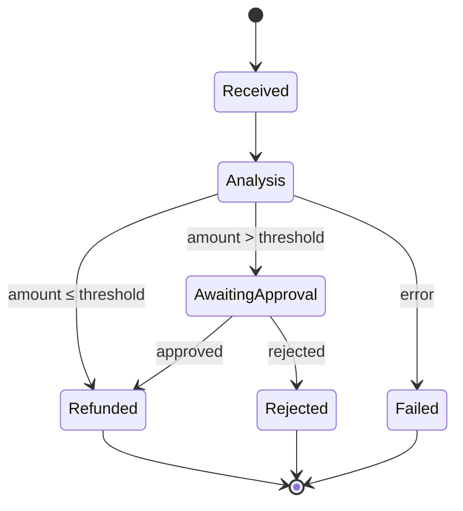
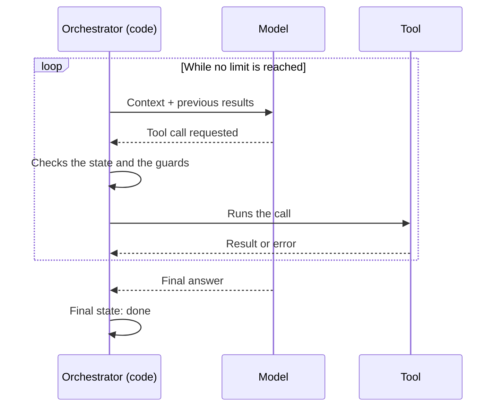

## States and transitions {#etats}

An agent in production has a **state**. A precise name, saved, readable.

Each state lists its allowed **transitions**. The rest is refused.

:::pourquoi
You always know where the agent stands.
You know what it is allowed to do now.
An action outside the graph can't happen.
:::

The **code** sets the graph. The **model** picks among the allowed transitions.

:::pourquoi
The model proposes. The machine decides.
The graph can be tested without a model.
:::

Anthropic tells two forms apart. A **workflow** follows “predefined code paths”. An **agent** “dynamically” directs its own process and tool usage.

:::pourquoi
The state machine takes the best of both.
The model keeps the initiative.
The code keeps the limits.
:::

Business rules go in **guards**: conditions checked before a transition.

:::pourquoi
Claudius sold below what it paid.
A “price ≥ cost” guard would have refused that change.
An instruction in the prompt can be forgotten.
:::

Always plan **final states**: done, failed, cancelled.

:::pourquoi
Without a final state, you can't tell whether a task is over.
“Failed” triggers an alert or a retry.
:::

## The agent loop {#boucle}

The heart of an agent is a loop.

It stops in two cases: the model answers without calling a tool, or a **limit** is reached.

:::pourquoi
The model can go round in circles.
Anthropic recommends stopping conditions, such as a maximum number of iterations.
:::

Three limits:

| Limit | Prevents |
|---|---|
| Number of turns | The endless loop |
| Token or cost budget | The surprise bill |
| Maximum duration | The task stuck for hours |

:::pourquoi
Each limit covers a different risk.
The first one reached stops the loop, with the “failed” state.
:::

Detect repetitions: same tool, same arguments, several times.

:::pourquoi
The same call gives the same result.
The agent is stuck. Better to say so than to pay for ten more turns.
:::

When a tool fails, **tell** the model. Clearly.

:::pourquoi
Anthropic saw it: an agent that knows a tool is failing changes strategy.
One that has the error hidden from it builds on nothing.
:::

## Key points

- An explicit state, listed transitions, final states.
- The code sets the graph and the guards. The model chooses within that frame.
- The loop stops on a final answer or on a limit: turns, cost, time.
- Tool failures are told to the model, not hidden.
