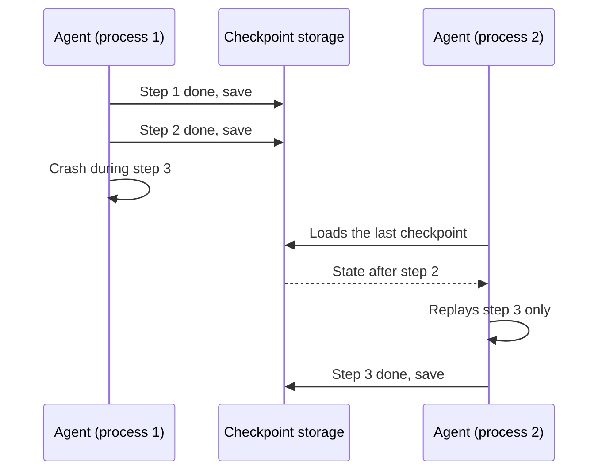
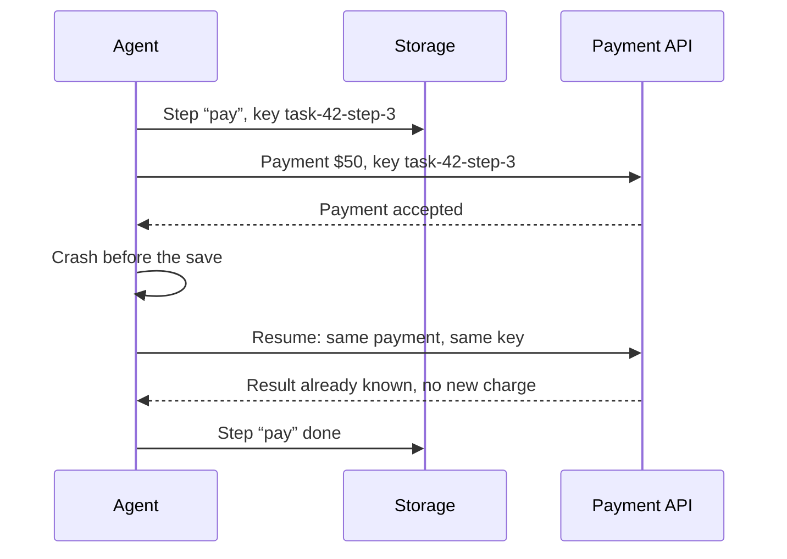

## Checkpoint {#checkpoint}

An agent can run for hours. The process can die at any moment.

A **checkpoint** saves the state after each step. In durable storage.

:::pourquoi
Whatever is only in memory dies with the process.
A database survives the crash.
:::

What it holds:

| Item | Used to |
|---|---|
| Current state | Know where you stand |
| Tool results | Not redo the work |
| Useful context | Let the model carry on |
| Format version | Read it after an update |

:::pourquoi
Each missing item forces you to redo or to guess.
:::

A checkpoint also makes **waiting** free. The agent is waiting for a human? Save, and free the process.

:::pourquoi
A process that waits a whole day holds resources.
And it may restart in the meantime.
:::

## Resuming after a crash {#reprise}

Resuming means reloading the last checkpoint and carrying on.

:::pourquoi
Anthropic writes it about its research system.
Restarting a long agent from scratch is “expensive and frustrating”.
They resume from where the error happened.
:::

Deployments interrupt too. Anthropic runs the old and the new version side by side, and moves traffic over gradually.

:::pourquoi
A running agent follows the code it started with.
Changing that code on the way can break its state.
:::

Put a **version number** in every checkpoint.

:::pourquoi
The code changes. The saves stay.
The version says how to read it, and which migration to apply.
:::

## Idempotency {#idempotence}

On resuming, the interrupted step is **replayed**. It may already have acted.

An **idempotent** operation has the same effect done once or twice.

:::pourquoi
“Set the status to paid”: twice, same result.
“Add $10”: twice, $20.
Only an idempotent step can be replayed safely.
:::

For APIs that allow it, send an **idempotency key**. Stripe, for example, takes it in a header and returns the same result for the same key.

:::pourquoi
The server recognizes the request it already handled.
It doesn't do it again.
:::

The key stays the **same** from one attempt to the next: task id plus step number, or generated once and saved before the call.

:::pourquoi
A new key on each try protects nothing.
The server would see two different requests.
:::

With no key on the API side, build idempotency yourself: note the intent, check before acting, mark it done.

:::pourquoi
The record says whether the action already happened.
A small window of doubt remains. You log it.
:::

## Key points

- A checkpoint after each step, in durable storage, with a version.
- Resuming: reload, then replay only the interrupted step.
- Every step that can be replayed must be idempotent.
- A stable idempotency key: the same key for each attempt.
