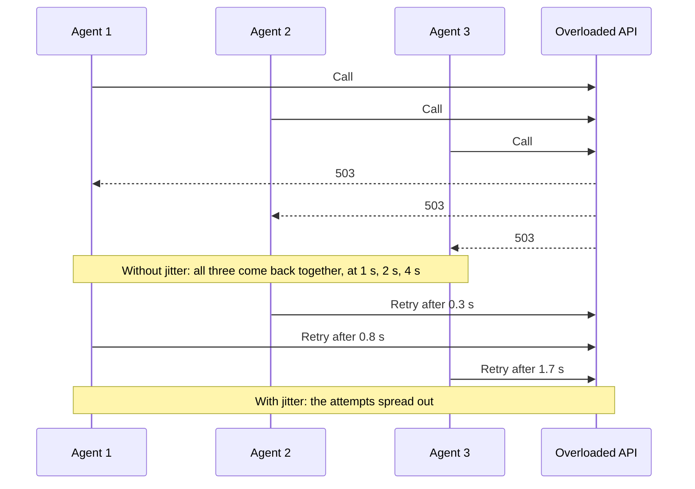

## Timeouts {#timeouts}

Any call can go unanswered. Every call has a **timeout**.

:::pourquoi
With no limit, the agent waits forever.
The timeout turns silence into an error you can handle.
:::

Choose the value from the **measured latency**. A high percentile, with a margin.

:::pourquoi
Too short, you cut calls that were going to succeed.
Too long, you wait for nothing.
:::

Add an **overall deadline** for the whole task.

:::pourquoi
A hundred 30-second calls each respect their timeout.
Together, they make 50 minutes.
:::

A timeout doesn't say the operation failed.

:::pourquoi
The server may have handled it, then answered too late.
Before retrying an action, you need idempotency.
:::

## Exponential backoff and jitter {#backoff}

You don't retry right away. You wait, longer and longer: that is **exponential backoff**.

You add **jitter**: each client draws its wait at random.



:::pourquoi
A thousand clients retrying at the same instant recreate the overload.
Marc Brooker (AWS, 2015) simulated it: without jitter is clearly the worst option.
:::

The “full jitter” formula:

```text
wait = random(0, min(cap, base × 2^attempt))
```

:::pourquoi
The exponential leaves the service more and more room.
The cap avoids waiting for hours.
The randomness spreads the clients out.
:::

The server says when to come back? Listen to it. A `429` with `Retry-After: 20` means: not before 20 seconds.

:::pourquoi
The server knows its load better than you do.
:::

## Capping retries {#limites}

Not every error is retried.

| Error | Retry? | Why |
|---|---|---|
| Timeout, 503, 429 | Yes, with backoff | Often transient |
| 400, invalid argument | No, send it back to the model | It will happen again |
| 401, 403 | No, escalate | A permission is missing |

:::pourquoi
Backoff doesn't fix a badly written date.
The model can fix it, if you tell it why.
:::

Set a **maximum number** of attempts. Then: “failed” state, alert, human.

:::pourquoi
After a few tries, the outage is no longer transient.
Insisting loads the service and delays the response.
:::

Retry at **one layer only**.


:::pourquoi
Attempts multiply from one layer to the next.
In the middle of an outage, they are what finishes the service off.
:::

## Key points

- One timeout per call, plus an overall deadline. A timeout is not a sure failure.
- Exponential backoff, capped, with jitter. Respect `Retry-After`.
- Retry only transient errors. Content errors go to the model.
- Few attempts, at one layer only. Then an explicit failure.
