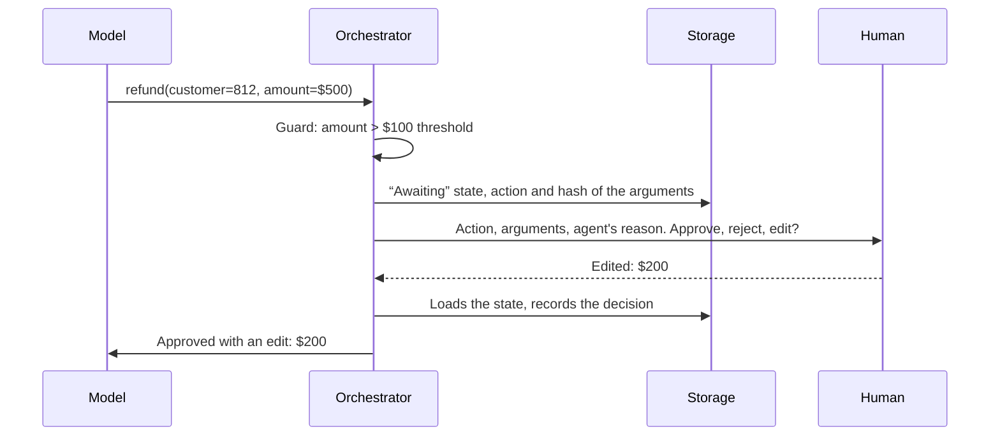

## Steps to approve {#a-valider}

Some steps go through a **human** before acting.

Which ones:

- the irreversible: deleting, sending, publishing;
- money: paying, refunding, granting a discount;
- what goes out: an email, a message, a request to the outside;
- production.

:::pourquoi
A reversible mistake can be fixed.
A transfer that has gone out can't.
The human goes where a mistake is costly.
:::

The threshold depends on the **risk**: amount, reversibility, recipient.

:::pourquoi
Claudius gave in to discount requests on Slack.
A threshold in code can't be talked round.
Above it, the human decides.
:::

No approval everywhere.

:::pourquoi
Too many requests, and the human clicks “yes” by reflex.
Approval loses all value.
:::

In the state machine, approval is a **state**: “awaiting”. The task is saved and the process freed.

:::pourquoi
A human may answer in three hours.
A checkpoint makes that wait free.
:::

## Approve or reject {#decision}

Show the **exact** action: tool, arguments, the reason the agent gave, expected effect.

:::pourquoi
“Refund” says neither how much nor to whom.
You can only judge what you see.
:::

Three answers: **approve**, **reject** with a reason, **edit**.

:::pourquoi
The reason for a rejection guides the agent.
An edit avoids starting all over.
:::

A rejection is sent back to the model. It proposes something else, or stops.

:::pourquoi
Retrying the same action ignores the human.
:::

The approval holds for **these** arguments. If they change, you ask again.

:::pourquoi
Otherwise you approve $50 and run $500.
A hash of the arguments ties the decision to the action.
:::

No answer? The action **doesn't happen**.

:::pourquoi
Silence is not agreement.
The request expires, you notify, you record it.
:::

Log every decision: who, when, what, which answer.

:::pourquoi
After an incident, you know who approved what.
And the numbers show where to adjust the threshold.
:::

## Key points

- Approve the irreversible, money, what goes outside, production. Not the rest.
- Approval is a saved state, not a process that waits.
- Show the exact action. Approve, reject, edit.
- Approval tied to the arguments. No answer, nothing goes out. Everything is logged.
