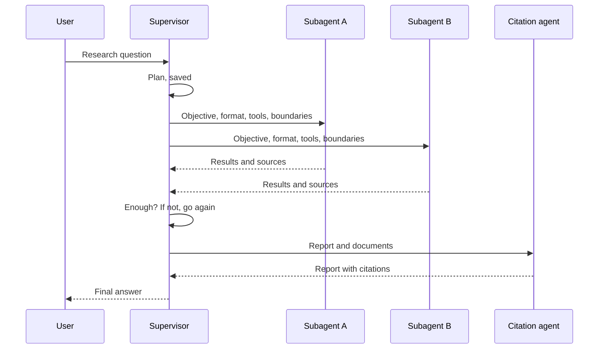
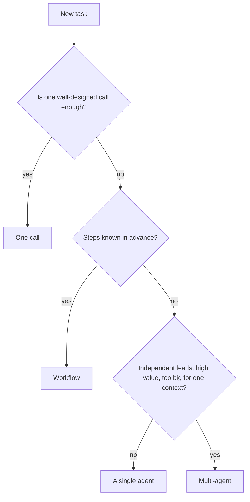

## Topologies {#topologies}

Several agents can work together. Three forms come up often.

| Topology | Principle | When |
|---|---|---|
| Orchestrator and workers | One agent splits, delegates, assembles | Split not known in advance |
| Parallelization by sectioning | Each agent handles one part | Independent parts |
| Parallelization by voting | Several agents, same task | Need for confidence |

:::pourquoi
Anthropic describes these patterns in “Building effective agents”.
Each meets a different need: speed, coverage, reliability.
:::

Anthropic built a research system as orchestrator and workers. An Opus 4 leads Sonnet 4 subagents. Result: +90.2% over a single Opus 4, on their internal evaluation.

:::pourquoi
Broad research questions can be explored in parallel.
Each subagent digs into one lead with its own context.
:::

The price: about **15 times** the tokens of a chat. A single agent: about 4 times.

:::pourquoi
Each subagent has its own context, its calls, its results.
The task must be worth that cost.
:::

## Supervisor {#superviseur}



The supervisor **splits**, **delegates**, **gathers**, **decides** when it is over.

:::pourquoi
Each subagent only sees one piece.
Only the supervisor sees the whole.
:::

Each delegation spells out: the objective, the output format, the tools, the boundaries.

:::pourquoi
A vague instruction gives duplicated or off-target work.
The boundaries also say what the others are doing.
:::

A precise task can have its own precise agent. At Anthropic, a dedicated agent adds the citations at the end.

:::pourquoi
Tying each claim to its source is a job of its own.
A specialized agent does it better than in passing.
:::

## Typed state {#etat-type}

The agents share a **typed state**: named fields, each with a type and an owner.

```json
{
  "question": "string",
  "leads": [{ "id": "string", "agent": "string", "status": "todo | running | done" }],
  "sources": [{ "url": "string", "excerpt": "string", "lead": "string" }],
  "report": "string | null"
}
```

:::pourquoi
A free-text summary can be read ten ways.
A typed field can be validated.
:::

Each field has a write rule: a single owner, or a defined merge.

:::pourquoi
“Last writer wins” wipes out work without a sound.
A list of sources is concatenated. A status has one master.
:::

A subagent's output is validated **before** it enters the state.

:::pourquoi
At the boundary, you know which agent produced the error.
After the merge, it contaminates everything.
:::

## Conflicts {#conflits}

Cognition tells an example. Task: a Flappy Bird clone. One subagent makes a Mario-style background. The other, a bird that doesn't match.

:::pourquoi
“Actions carry implicit decisions”: a style, an assumption.
An agent that doesn't see the other's choices decides differently.
Cognition draws a principle from it: share the full context.
:::

Two results contradict each other? The supervisor compares the sources. It decides, or it flags the disagreement.

:::pourquoi
The average of two wrong figures is still wrong.
A visible disagreement beats a made-up certainty.
:::

For a short, comparable answer, a **vote** works well: several agents, the majority wins.

:::pourquoi
“42”, “42”, “41” can be counted.
Three written reports can't.
:::

The MAST study (2025) classifies 14 failure modes into 3 categories: system design, misalignment between agents, task verification.

:::pourquoi
Most failures don't come from the model alone.
They come from how the agents are organized.
:::

## When one agent is enough {#un-seul}

Often.

Anthropic says it: multi-agent is a poor fit for tasks where everyone must share the same context, and for most coding.

:::pourquoi
In code, one decision constrains ten others.
Isolated subagents don't see those links.
:::

Cognition recommends a single, linear agent. When the context gets long, you compress it.

:::pourquoi
A single thread sees all its decisions.
Nothing is lost between two agents.
:::

On BrowseComp, token usage alone explains 80% of the performance variance Anthropic measured.

:::pourquoi
A good share of the gain comes from the spending.
The real question: is the task worth the cost?
:::



:::pourquoi
Anthropic advises starting with the simplest solution.
You add complexity only if it measurably improves the result.
:::

## Key points

- Orchestrator and workers, sectioning, voting: each topology has its use.
- The supervisor delegates with an objective, a format, tools, boundaries. It decides when it is over.
- Typed state, one owner per field, validation at the boundary.
- Conflicts come from unshared context. Compare sources, vote on what is comparable.
- One agent is often enough. Multi-agent costs about 15 times a chat.
