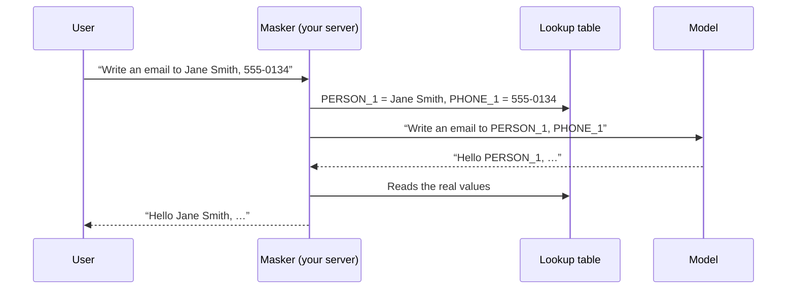
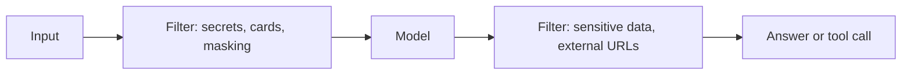

## Reversible masking {#masquage}

Before sending a text to the model, you **replace** personal data with tokens.

:::pourquoi
The model doesn't need the real name to write.
What it doesn't get, it can neither keep nor leak.
:::

The **table** stays with you. Not in the prompt, not in the logs.

:::pourquoi
The table is the key.
Sending it or logging it undoes the masking.
:::

The same name keeps the **same token** throughout the conversation.

:::pourquoi
Otherwise the model thinks it sees several people.
Masking must not break the task.
:::

Combine detectors: exact rules for known formats (email, phone, IBAN), a detection model for names.

:::pourquoi
A statistical detector misses cases.
5% missed over a million messages is 50,000 leaks.
:::

Restoring follows the **rights** of the source.

:::pourquoi
The agent must not show someone what they couldn't have seen themselves.
:::

Pseudonymising isn't anonymising. Under the GDPR, it is still personal data.

:::pourquoi
With the table, you find the person again.
The risk goes down. The obligations stay.
:::

## What never leaves {#jamais}

April 2023. Samsung engineers paste internal source code into ChatGPT to fix it. In early May, Samsung restricts these tools on its devices and networks.

:::pourquoi
The leak didn't come from an attack.
It came from normal use, with no safeguard.
OWASP ranks this risk second in 2025.
:::

Three categories:

| Category | Examples | Rule |
|---|---|---|
| Secrets | Passwords, API keys, tokens | Never in the context |
| Highly sensitive data | Credit card, health, ID documents | Blocked or masked before the call |
| The rest | Whatever the task doesn't need | Not sent: minimization |

:::pourquoi
What doesn't go into the context can't come out of it.
:::

API keys live in the **tool's code**. The model never sees them.

:::pourquoi
The model chooses the tool. The code adds the authentication.
Even under injection, it can't reveal a key it doesn't have.
:::

The system prompt is not a safe.

:::pourquoi
It is text in the context.
Users regularly manage to make it recite it.
:::

Filter **on the way in** and **on the way out**: answer, URLs, tool arguments.

:::pourquoi
The filtered input may let one case through.
A tool may bring back sensitive data along the way.
The output is the last checkpoint.
:::

## Key points

- Mask before the call, restore after. The table stays with you.
- Stable tokens, combined detectors, restoring according to rights.
- Pseudonymized is still personal under the GDPR.
- Never a secret in the context. The system prompt isn't secret.
- Filter on the way in and on the way out.
