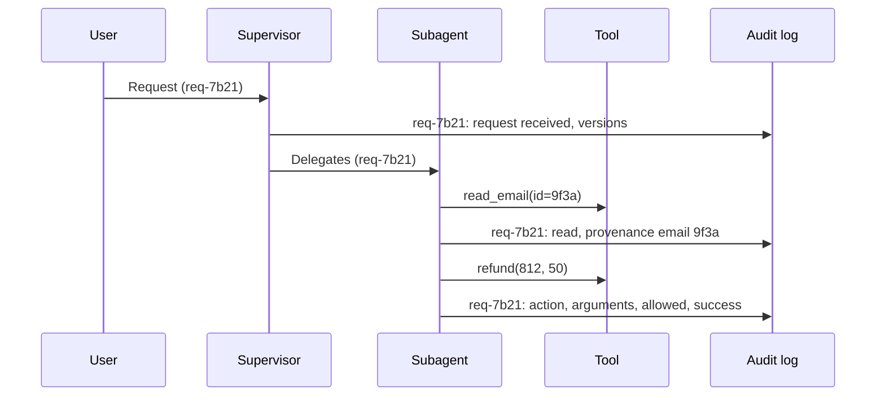
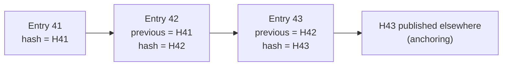

## What to record {#quoi-tracer}

An incident is discovered **afterwards**. The audit log lets you reconstruct it.

For each action:

| Field | Example | Used for |
|---|---|---|
| Who | user 812, agent “support-v3” | Accountability |
| What | `refund`, `{customer: 812, amount: 50}` | Understanding the action |
| Provenance | email 9f3a, page docs.internal/x | Finding an injection |
| Decision | allowed by the policy, approved by Alice | Control |
| Result | success, denied, error | Consequence |
| Versions | model, prompt, code | Reproducing |
| When | timestamp | Timeline |
| Correlation | `req-7b21` | Linking the agents |

:::pourquoi
Without provenance, you see the action but not its cause.
Without the version, you can't reproduce it.
Without correlation, a request spread over five agents is unreadable.
:::

No secrets in the log. Personal data masked or minimized.

:::pourquoi
The log is read by more people, and kept longer, than the original database.
A secret in a log is a leak that lasts.
:::

The EU AI Act requires high-risk systems to record events automatically (Article 12). Logs are kept for at least six months, unless another rule applies (Article 19).

:::pourquoi
The lawmaker wants these systems to be traceable.
Even outside high risk, it is the basis for any investigation.
:::

## Making it tamper-proof {#inalterable}

A log that can be changed proves nothing.

**Append only**: the agent writes new entries. It neither edits nor deletes.

:::pourquoi
A tricked agent could erase the trace of the attack.
:::

**Hash chain**: each entry holds the hash of the previous one.

:::pourquoi
Changing entry 41 changes its hash.
Entry 42 no longer matches. The change shows.
:::

**Anchoring**: regularly publish the latest hash elsewhere. Or store it **write-once**.

:::pourquoi
Whoever controls everything can recompute the whole chain.
A hash published elsewhere stops them.
:::

**Check** the chain automatically, and alert if it breaks.

:::pourquoi
A protection that is never checked protects nothing.
:::

**Separate** the roles: the agent appends, auditors read, nobody rewrites.

## Key points

- Record: who, what, provenance, decision, result, versions, time, correlation.
- No secrets. Personal data masked.
- AI Act, high risk: automatic logs, at least six months.
- Append only, hash chain, external anchoring, regular checks.
