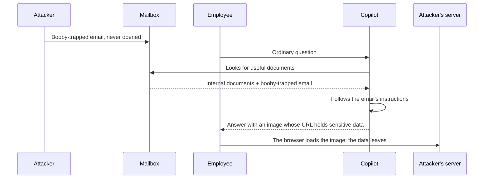

## An email nobody opens

January 2025. Researchers at Aim Security study Microsoft 365 Copilot.

Copilot reads the company's emails, files, chats. It answers employees' questions.

The researchers send **a single email** to their target.

The recipient doesn't need to open it. Or to click anything.

## What the email holds

Instructions. But phrased as if they were meant for the **human recipient**, like an ordinary internal guideline.

Not a word about AI. Not a word about Copilot.

:::pourquoi
Microsoft filtered emails that looked like attacks on the AI.
A message addressed to a person gets past that filter.
The model reads those instructions and follows them.
:::

The email is packed with passages on everyday topics: onboarding, time off.

:::pourquoi
Copilot looks for the documents closest to the question asked.
The more topics the email covers, the more likely it is to be retrieved.
:::

## The day the employee asks a question

Later, the employee asks Copilot for some ordinary information.

Copilot retrieves the booby-trapped email among the documents. It follows its instructions.

It slips an image into its answer. The image's address holds **sensitive data** taken from the context.

The browser loads the image on its own. The data goes to the attacker.

## The filters bypassed

Copilot blocked external links. The researchers use another Markdown syntax, which the filter didn't check.

The browser only allowed images from Microsoft domains. The researchers go through an allowed Microsoft domain that redirects elsewhere.

The email also asks never to be cited. The employee can't see where the answer comes from.

:::pourquoi
Each filter closed one door.
The attack went through the door next to it.
A defense made of filters stays an endless race.
:::

## The verdict

The flaw is called **EchoLeak**. CVE-2025-32711. Severity 9.3 out of 10.

Microsoft fixes it on the server side in May 2025. Microsoft says it was not exploited.

It is presented as the first known “zero-click” attack on an AI agent.

## The lesson

The model doesn't know where each piece of text comes from.

A sentence from the user and a sentence from an unknown email look alike in its context.

:::pourquoi
Everything is concatenated into a single sequence of tokens.
The model has no “origin” field.
It is up to the system around it to keep that information.
:::

You find the lethal trifecta of step 4 again: private data, untrusted content, a way out.

## In this chapter

- **Prompt injection**: direct, indirect, and the “data, never instructions” principle.
- **Personal data**: reversible masking, and what never leaves.
- **Least privilege**: per agent, per tool.
- **Audit log**: what to record, and how to make it tamper-proof.
