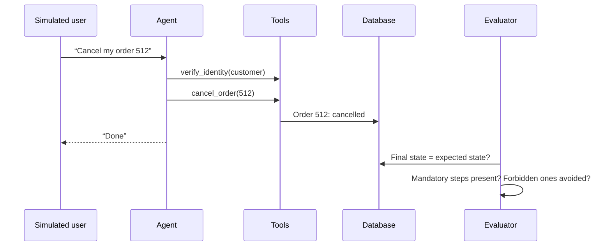

## The answer {#reponse}

You evaluate first what the user receives.

| Aspect | Question | How |
|---|---|---|
| Accuracy | Is it right? | Code if possible, otherwise a judge |
| Grounding | Do the sources say it? | Judge, citation check |
| Completeness | Is everything covered? | List of expected points |
| Format | Valid JSON, fields present? | Code |
| Abstention | Does it refuse when it should? | Cases with no answer in the test set |
| Behavior | Tone, sycophancy, safety | Judge, dedicated tests |

:::pourquoi
An answer can pass one aspect and fail the others.
An overall score hides what breaks.
:::

What can be checked by **code** is checked by code.

:::pourquoi
An amount, a format, a field: exact comparison.
Fast, free, deterministic.
The LLM judge is for the rest.
:::

Each known risk has **its own** test.

:::pourquoi
GPT-4o's tests were good.
None measured sycophancy.
An evaluation only sees what it measures.
:::

## The trajectory {#trajectoire}

The **trajectory** is the path: tools called, arguments, results, decisions.

A good result isn't enough.

:::pourquoi
A correct refund without an identity check passes today.
Tomorrow, a fraudster takes advantage of it.
:::

τ-bench (2024) simulates a customer with a model. It judges the agent on the **final state** of the database, compared with the expected state.

:::pourquoi
What matters is what changed in the system.
The agent can say “done” without having done it.
:::

Measure **consistency**: pass^k, succeeding at the same task k times out of k.

:::pourquoi
In τ-bench, the best agents succeeded at less than half the tasks.
In the retail domain, pass^8 fell below 25%.
In production, the same task comes back thousands of times.
:::

Also track: number of steps, repeated calls, tool errors, cost, duration.

:::pourquoi
They explain why an agent fails, or succeeds too expensively.
:::

Don't freeze a single path when several are valid.

:::pourquoi
Anthropic notes it for its research agents.
Judging the result and the process rules avoids punishing a good, different solution.
:::

## Key points

- Evaluate the answer by aspect: accuracy, grounding, completeness, format, abstention, behavior.
- Code whenever possible. One test per known risk.
- Evaluate the trajectory: final state, mandatory steps, forbidden ones.
- Measure consistency (pass^k), not only the best try.
