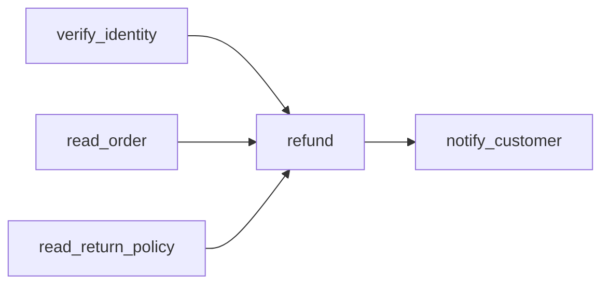

## Golden set {#golden-set}

A **golden set**: fixed test cases, each with its expected result, checked by a human.

```yaml
- id: refund-017
  input: "I want a refund for order 512, the item arrived broken."
  expected:
    final_state: { order_512: refunded, amount: 49.90 }
    mandatory_steps: [verify_identity, read_order, refund]
    forbidden: [send_external_email]
  origin: "real ticket #8812, anonymized"
```

:::pourquoi
Without a fixed reference, you can't compare two versions.
You compare impressions.
:::

Where the cases come from:

- **real requests**, anonymized;
- every **bug** fixed;
- **edge cases** written on purpose: no answer, ambiguous, malicious.

:::pourquoi
A bug turned into a test can't come back unseen.
Edge cases are costly when they fail.
:::

Show an **error bar**. Compare versions **case by case**.

:::pourquoi
With 20 cases, one case flipping is 5 points.
Anthropic recommends giving the standard error with every score.
And analyzing paired differences: same case, two versions.
:::

Keep a **held-out** set, never used to tune the prompt.

:::pourquoi
Tune on the same cases long enough and the prompt learns them.
The score goes up. The real behavior doesn't.
:::

## Expected DAG {#dag}

For an agent, what is expected is often a **path**. But not a single path.

A **DAG** (directed acyclic graph) describes the required steps and their dependencies.



`read_order` and `read_return_policy` can come in any order. `refund` comes after all three.

:::pourquoi
An ordered list rejects correct trajectories.
The DAG only imposes the real dependencies.
:::

You check:

| Check | Fails if |
|---|---|
| Presence | A mandatory step is missing |
| Dependencies | A step comes before what it depends on |
| Forbidden | A forbidden action appears |
| Arguments | A key field differs: id, amount |
| Extras | Allowed, but counted in the cost |

:::pourquoi
Each check catches one family of errors.
Together, they judge the path without freezing it.
:::

Compare arguments **field by field**, with one rule per field.

:::pourquoi
The id must be exact.
A search query can be phrased ten ways.
:::

## Per-step score {#note-etape}

You score **each step**, not only the end.

| Step | Criterion | Score |
|---|---|---|
| 1. verify_identity | Right tool, right arguments | pass |
| 2. read_order | Right id | fail (id 215 instead of 512) |
| 3. read_order | Correction after the error | pass |
| 4. refund | Right amount, after verification | pass |

:::pourquoi
“Failed” doesn't say what to fix.
“Wrong argument at step 2” does.
:::

A **simple, defined** scale: pass or fail, or a few described levels.

:::pourquoi
A score from 0 to 100 with no definition isn't reproducible.
Two graders will give two numbers.
:::

The criteria **change**. Shankar and his coauthors (2024) call it criteria drift.

:::pourquoi
Grading real outputs makes you discover new criteria.
You revise the rubric after reading results, not only before.
:::

## Key points

- Golden set: fixed cases, checked expectations, drawn from real use, bugs and edge cases.
- Error bars, case-by-case comparison, a held-out set.
- Expected DAG: mandatory steps, dependencies, forbidden actions. No needless order.
- Per-step score, a simple scale, a rubric revised by reading the results.
