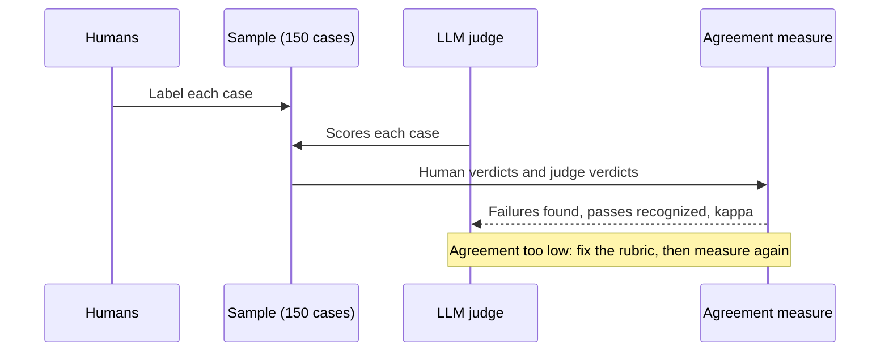

## Rubric {#grille}

Some criteria can't be checked by code: grounding, tone, relevance. You then ask an **LLM judge**.

:::pourquoi
“Is the answer polite?” can't be tested with an `if`.
But a judge costs, varies and has biases.
Code comes first when it is enough.
:::

A good rubric:

```text
Criterion: GROUNDING
Definition: every factual claim in the answer is supported
by at least one of the documents provided.
Pass if: every claim is supported.
Fail if: at least one claim is supported by no document.
Fail example: the answer says “delivery in 24 hours”, no document says so.
Output: {"justification": "...", "verdict": "pass" | "fail"}
```

:::pourquoi
One criterion at a time: the judge doesn't mix them up.
A definition and examples: it knows where the line is.
A structured output: code reads it.
:::

Prefer **binary** verdicts, one per criterion.

:::pourquoi
Between 6 and 7 out of 10, the judge hesitates and changes its mind.
Pass or fail is reproducible, and can be compared with a human.
:::

Ask for the **justification before** the verdict.

:::pourquoi
The judge looks at the evidence before deciding.
And you can read why it decided.
:::

## Calibration {#calibrage}

The judge is a model. It must be **checked**.



:::pourquoi
Without calibration, you don't know what the score is worth.
You may be measuring the judge, not the agent.
:::

Raw agreement can mislead.

| Measure | Question |
|---|---|
| Failures found | Of the real failures, how many does the judge see? |
| Passes recognized | Of the real passes, how many does it accept? |
| Cohen's kappa | Agreement, once chance agreement is removed |

:::pourquoi
If 90% of the answers are good, a judge that always says “pass” gets 90% agreement.
And finds no failure.
:::

Zheng and his coauthors (2023) measure over 80% agreement between GPT-4 and humans, the same as between humans.

:::pourquoi
That is encouraging, but it was their task.
On yours, you must measure again.
:::

Every change of the judge's model or rubric calls for a **new calibration**.

:::pourquoi
Another judge is another ruler.
The old scores can no longer be compared.
:::

## Bias {#biais}

LLM judges have known biases.

| Bias | Effect | Fix |
|---|---|---|
| Position | Prefers A or B depending on order | Judge in both orders |
| Verbosity | Prefers the longer one | “Concise” criterion, length check |
| Self-enhancement | Prefers its own style | Judge from another model family |
| Limited reasoning | Misses a calculation or logic error | Check by code when possible |

:::pourquoi
Zheng and his coauthors list these four limits.
Each fix removes one known source of error.
:::

Optimizing against a judge also optimizes its **flaws**.

:::pourquoi
GPT-4o was also trained on users' thumbs.
Users like being told they are right.
The model became sycophantic.
A judge that likes long answers teaches the agent to pad.
:::

## Key points

- The LLM judge is for what code can't judge.
- Rubric: one criterion, a definition, examples, a binary verdict, the justification first.
- Calibrate against humans. Measure the failures found, not only agreement.
- Know the biases: position, verbosity, self-enhancement. Optimizing a judge optimizes its flaws.
