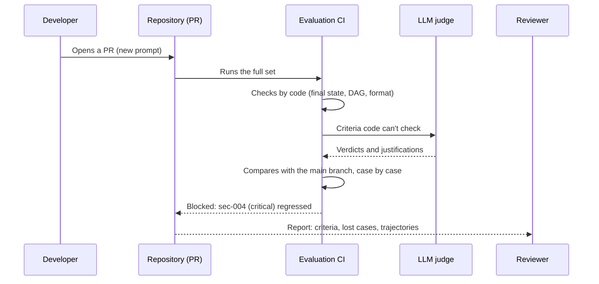

## Regressions {#regressions}

Every change can break what used to work. That is a **regression**.

What should rerun the evaluation:

- the prompt;
- the model or its version;
- the tools and their descriptions;
- the schemas;
- the agent's code;
- the search settings.

:::pourquoi
Behavior depends on all of that.
The prompt is code. It is tested like code.
:::

Look at the **cases that change**, not only the score.

| Case | Before | After |
|---|---|---|
| refund-017 | pass | fail |
| refund-022 | fail | pass |
| sec-004 (critical) | pass | fail |

:::pourquoi
82% then 81% may hide 10 cases gained and 11 lost.
Including, maybe, a critical case.
:::

Cut the **noise**: several samples per case, an average per case, a paired comparison.

:::pourquoi
Outputs vary from one run to the next.
Anthropic recommends resampling, showing an error bar, and comparing the same cases between versions.
:::

Two levels: a **small fast set** on every commit, the **full set** before merging or going to production.

:::pourquoi
The full set with a judge costs time and tokens.
The small set gives immediate feedback.
:::

## Blocking a PR {#bloquer-pr}

An evaluation that can't **block** anything is just an opinion.

:::pourquoi
At OpenAI, testers had sensed a problem.
Their view didn't block the release.
OpenAI now treats this kind of issue as blocking.
:::

Two blocking rules:

1. A **critical case** fails: security, money, personal data.
2. A criterion **drops beyond** its error bar.

:::pourquoi
A critical case isn't offset by 15 improved cases.
A drop within the noise must not block, or people learn to ignore CI.
:::

The **report** on the PR: scores per criterion with error bars, cases gained and lost, a link to each trajectory.

:::pourquoi
The reviewer must understand in a minute what moved, and why.
:::

An **emergency exit**: a designated person can override, with a written, recorded justification.

:::pourquoi
A case may be badly written. A judge may be wrong.
But an invisible bypass kills the rule.
:::

## Key points

- Any change of prompt, model, tool or schema reruns the evaluation.
- Look at the cases that change, with an error bar.
- A small fast set on every commit, the full set before merging.
- Block on a critical case or a significant drop. A readable report. Overrides recorded.
