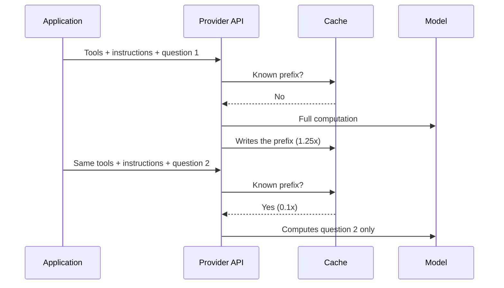
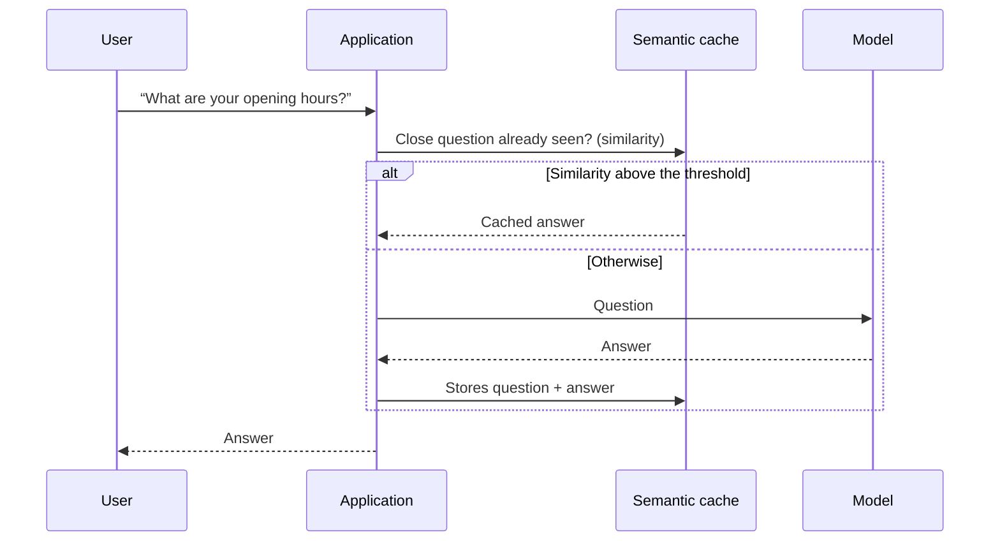

## Prompt caching {#cache-prompt}

Many requests start the same way: same tools, same instructions, same documents.

The **prompt cache** keeps the computation done on that start. The next request picks it up.

:::pourquoi
The start of the prompt is often the longest part.
Recomputing it each time costs time and money.
The answer is still generated afresh.
:::

The cache works on an **exact prefix**. Stable first, variable at the end.

:::pourquoi
The cache stops at the first different character.
At Anthropic, the order is: tools, then system, then messages.
Changing a tool invalidates everything after it.
:::

| Position | Content |
|---|---|
| Start | Tools, instructions, reference documents |
| Middle | Conversation history |
| End | The current question, date, time |

Prices at Anthropic, for most models:

| Operation | Price compared with the normal price |
|---|---|
| Write, 5-minute cache | 1.25x |
| Write, one-hour cache | 2x |
| Read | 0.1x |

:::pourquoi
Two calls without a cache: 2.
With a cache: 1.25 + 0.1 = 1.35.
The gain starts from the second use.
:::

Each read **refreshes** the 5-minute cache. Prompts that are too short aren't cached.

:::pourquoi
Steady traffic keeps the cache warm.
Below a minimum length, the gain isn't worth the bookkeeping.
The minimum length depends on the model.
:::

At OpenAI, caching is **automatic** above a minimum length. The discount depends on the model.

:::pourquoi
Nothing to turn on. But the same rule applies:
a stable prefix, or no discount.
The `cached_tokens` field in the response says what was reused.
:::

A cache shared between users can **leak** through response time.

:::pourquoi
A cached prefix answers faster.
An attacker can try a prompt prefix and time it.
In 2025, Gu et al. detected a cache shared between users at seven providers.
:::

## Semantic caching and its risks {#cache-semantique}

The **semantic cache** goes further. It keeps whole answers.

If a question is close enough to an old one, it returns the old answer. Without calling the model.

:::pourquoi
No model call: almost zero cost, immediate answer.
Useful for frequent questions, like an FAQ.
:::

First risk: the **false positive**. A close question isn't the same question.

| Cached question | New question | Problem |
|---|---|---|
| How do I enable 2FA? | How do I disable 2FA? | Opposite meaning |
| Status of order 512? | Status of order 513? | Another order |
| Price in 2025? | Price in 2026? | Another year |

:::pourquoi
The vectors of these sentences are very close.
A single word changes the meaning.
The cache doesn't read: it measures a distance.
:::

Second risk: the **leak**. “What is my balance?” doesn't have the same answer for everyone.

:::pourquoi
A global cache returns the first user's answer to the next.
It is a personal data leak.
:::

Third risk: the **stale** answer. A price, a stock level or a status changes.

:::pourquoi
The cached answer was right yesterday.
It is wrong today, and the cache doesn't know.
:::

The rules:

- Only cache what is **general and stable**: no personal data, no action.
- **Partition** by user or by customer.
- Set a **lifetime** and be able to **purge** an entry.
- Set the **threshold** on labeled question pairs.

:::pourquoi
A wrong answer in the cache repeats on every visit.
The threshold is set like an evaluation: by counting errors.
:::

## Key points

- Prompt caching: stable first, variable at the end. Pays off from the second use.
- No timestamp at the top of the prompt.
- Semantic caching: fast and free, but false positives, leaks and stale answers.
- Partition, limit in time, set the threshold on real data.
