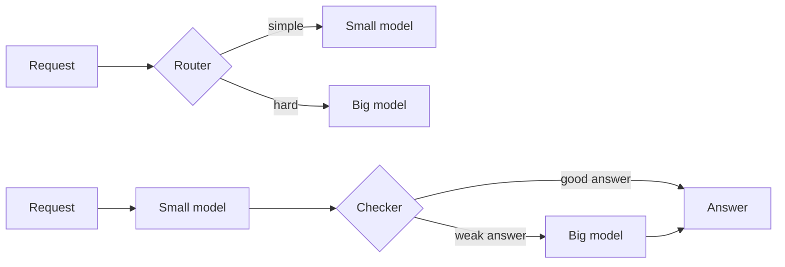
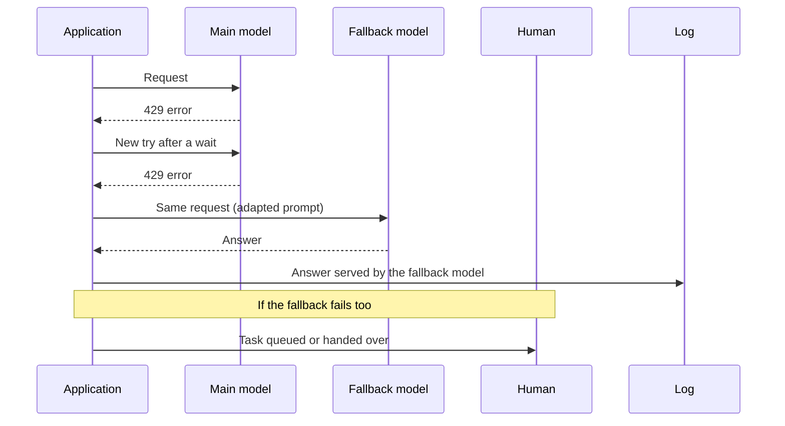

## By complexity {#selon-complexite}

Not all requests are equal. **Routing** sends each one to the cheapest model that handles it well.

:::pourquoi
Sorting an email doesn't need the biggest model.
Paying for the big model on everything means paying for difficulty on every easy request.
:::

| Task | Model |
|---|---|
| Classify, extract, rephrase | Small |
| Answer from provided documents | Medium |
| Plan, reason at length, code across several files | Big |

Two ways to route:

- The **router** decides **before**, from the request.
- The **cascade** decides **after**, from the small model's answer.

:::pourquoi
RouteLLM (2024) learns a router from human preferences.
On MT Bench, it keeps 95% of GPT-4's performance with 26% of requests sent to GPT-4.
FrugalGPT (2023) describes the cascade and reports up to 98% savings at GPT-4 level on its tests.
:::

A cascade has a **hidden cost**.

:::pourquoi
A request that moves up pays for two models and waits twice.
If many move up, the cascade costs more than the big model alone.
You track the escalation rate.
:::

Routing is **evaluated** branch by branch.

:::pourquoi
A saving that breaks answers isn't a saving.
The test set from step 7 says whether the small model holds its branch.
:::

## Fallback chains {#repli}

A provider goes down. A rate limit is hit. The model doesn't answer.

The **fallback chain** takes over.

:::pourquoi
Without a fallback, your outage follows the provider's.
With a fallback, the service carries on, maybe a little less well.
:::

The rules:

1. **Retry** first, with growing waits.
2. **Switch** if the error persists.
3. **Fail cleanly** at the end of the chain.

:::pourquoi
A transient error often clears with waiting.
An endless chain becomes a costly loop.
A clean failure beats a made-up answer.
:::

The fallback is for **outages**, not **refusals**.

:::pourquoi
A safety refusal is a decision.
Replaying it elsewhere means hunting for the most permissive model.
:::

The fallback model goes through the **same test set**.

:::pourquoi
The same prompt doesn't work the same on every model.
The fallback is only used in a crisis: a bad time to discover its flaws.
:::

You **log** which model answered.

:::pourquoi
A drop in quality may come from a fallback left active all day.
Without a record, you look in the wrong place.
:::

## Key points

- Route: a small model for the simple, a big one for the hard.
- Router before, cascade after. Watch the escalation rate.
- Fallback: retry, switch, fail cleanly.
- Never a fallback to get around a refusal. The fallback is tested and logged.
