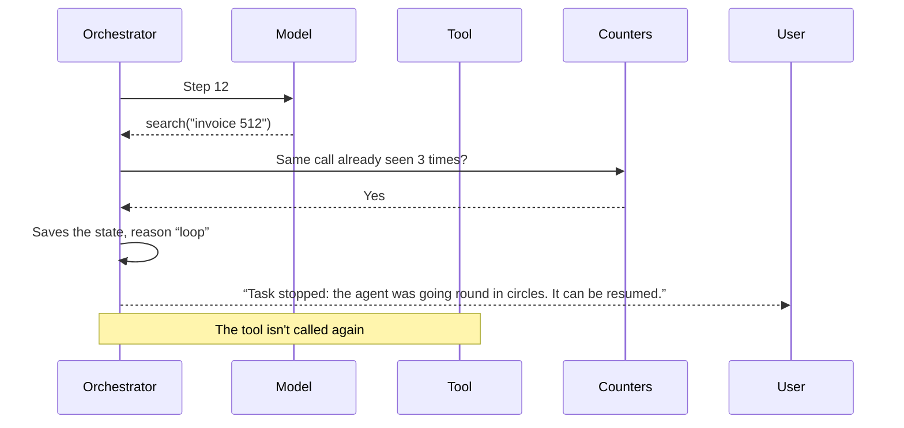

## Budgets {#budgets}

A model call has a predictable cost. An **agent** doesn't.

:::pourquoi
The agent decides on its own to call the model again.
A loop that doesn't end properly runs as long as nobody stops it.
At Anthropic, a 200-dollar subscriber used tens of thousands of dollars of compute.
:::

A budget at **three levels**:

| Level | Example | What it stops |
|---|---|---|
| Task | 200,000 tokens, 30 steps, 10 minutes | A loop |
| User or customer | $20 a day | An abuse |
| Organization | $5,000 a month | A bill out of control |

:::pourquoi
Each level stops a different problem.
A single level lets the other two through.
:::

A task's budget combines several **units**: tokens, steps, tool calls, duration, money.

:::pourquoi
A paid tool, such as a web search, counts in money.
A loop of short calls shows up in steps, not in tokens.
:::

An **alert** before the limit. A **cutoff** at the limit.

:::pourquoi
At 80%, the agent can wrap up with what it has.
At 100%, you cut it off.
A budget that grows on its own isn't a budget.
:::

## Automatic cutoff {#coupure}

Some signals must **stop** the agent without waiting for the budget.

| Signal | What it reveals |
|---|---|
| Same tool call, same arguments, several times | A loop |
| Same tool error repeated | A misunderstood schema |
| No progress toward the goal after N steps | A lost agent |
| Overall spending triples in an hour | A bug, a loop or an abuse |

:::pourquoi
A looping agent no longer makes progress. It consumes.
Catching it early avoids paying a hundred times for the same failure.
:::

The cutoff lives in the **orchestrator**, not in the prompt.

:::pourquoi
A looping model doesn't know it is looping.
An instruction “stop if you are looping” guarantees nothing.
The code counts, and cuts off.
:::

After the cutoff: a **saved state**, the **reason**, a **clear message**.

:::pourquoi
The state lets you resume after a fix.
The reason helps fix the cause.
Restarting as is runs the same loop again.
:::

At the organization level, a **circuit breaker** suspends what isn't critical and alerts a person.

:::pourquoi
Waiting for the bill means paying before understanding.
:::

## Quotas {#quotas}

A **quota** bounds a user's or a customer's usage over a period.

:::pourquoi
The budget protects your bill.
The quota also protects the service and the other users.
:::

Two **windows** complement each other:

| Window | What it stops |
|---|---|
| Short (a minute, a few hours) | Bursts |
| Long (a day, a week) | Continuous use |

:::pourquoi
Anthropic already had a limit that resets every five hours.
Agents ran day and night, from one window to the next.
The weekly limit, announced in July 2025, bounds the total.
:::

The quota also targets **sharing** and **reselling** access.

:::pourquoi
Ten people on one account consume like ten.
Anthropic cited these practices among the abuses targeted.
:::

A reached quota is **explained**: what, until when, and the paid option if there is one.

:::pourquoi
A surprise quota looks like an outage.
An explained quota is a rule.
:::

OWASP makes it a risk of its own: **LLM10, Unbounded Consumption**.

:::pourquoi
An attacker can flood your service and send you the bill.
Quotas and rate limits are the basic defense.
:::

## Key points

- An agent has no natural ceiling: you have to give it one.
- Budgets per task, per user, for the organization. Alert before, cut off at the limit.
- The cutoff lives in the orchestrator's code, not in the prompt.
- Quotas on two windows, explained to the user.
