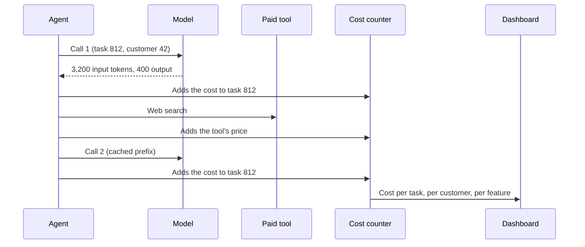

## Cost per task {#cout-tache}

The bill says **how much**. The cost per task says **where** and **why**.

:::pourquoi
A task that costs 50 times the average drowns in the bill.
Per task, you see which flow, which customer, which prompt costs.
:::

An agent task is several calls. You add everything up:

| Line | Example |
|---|---|
| Input tokens | Prompt, history, tool results |
| Tokens read from cache | Stable prefix, at a reduced price |
| Output tokens | Answers, tool calls |
| Reasoning tokens | Often billed as output |
| Paid tools | Web search, external API |
| Retries | Errors, fallbacks, cascade |

:::pourquoi
Forgetting a line means underestimating the cost.
Failed tries cost as much as successful ones.
:::

The figure that matters: the **cost per successful task**.

:::pourquoi
100 tasks, $50, 80 successes: $0.625 per success.
A cheaper model that fails more can cost more per success.
:::

The cost of a step **grows** with the history.

:::pourquoi
Step 20 sends back the 19 before it.
Prompt caching and summarizing the history slow that growth.
:::

You **tag** each call: task, customer, feature.

:::pourquoi
Without a tag, a cost has no owner.
The same counters feed the budgets and the quotas.
:::

## p50 and p95 latency {#latence}

The **average** hides the tail. You measure **percentiles**.

| Measure | Meaning |
|---|---|
| p50 | Half the requests are faster |
| p95 | 19 requests out of 20 are faster |
| p99 | 99 out of 100 are faster |

:::pourquoi
99 requests at 1 second, one at 60 seconds: average 1.6 seconds.
One user in a hundred waited a minute.
:::

The tail **dominates** when steps are chained.

:::pourquoi
Dean and Barroso (2013): a request queries 100 servers, each slow once in 100 times.
About 63% of requests hit at least one slow server.
An agent that chains calls lives the same effect.
:::

Two measures for two uses:

- **Time to first token**: the wait felt in a chat.
- **Total time**: what matters for an agent that must finish before acting.

:::pourquoi
With streaming, the user reads from the first word.
An agent only acts once the answer is complete.
:::

You measure **per step** and **end to end**.

:::pourquoi
End to end: what the user experiences.
Per step: where the time goes.
A slow tool often hides behind a model wrongly blamed.
:::

To shrink the tail:

- fewer steps in series;
- steps **in parallel** when they are independent;
- prompt **caching**;
- a **small model** for simple steps;
- a **maximum delay** per call, with a fallback.

:::pourquoi
Each step in series adds its wait and its risk of being slow.
Caching and the small model shorten each step.
The maximum delay cuts off the longest tail.
:::

## Key points

- Measure the cost per successful task, every line included.
- Tag each call: task, customer, feature.
- Latency at p50 and p95, not on average. Per step and end to end.
- Steps in series make the tail grow.
