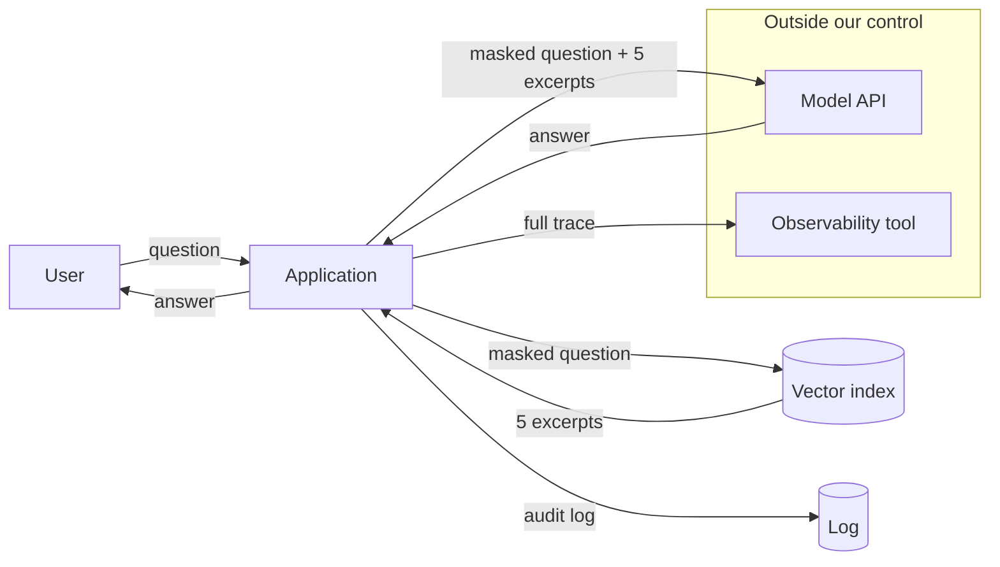
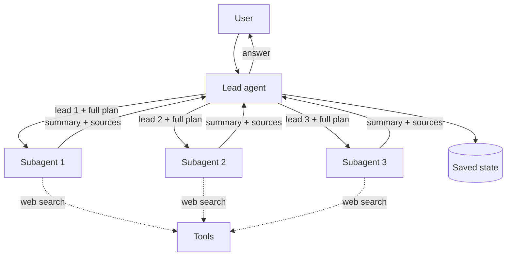

## Data flow {#flux-donnees}

The **data flow** follows the data, not the code: where it comes from, where it goes, where it stays.

:::pourquoi
You see at a glance what leaves your premises.
Each arrow that crosses the boundary is a security question.
:::

Three rules:

1. Each arrow carries a **label**: what goes through.
2. **Trust boundaries** are drawn.
3. **Copies** are visible: logs, traces, caches.

:::pourquoi
An unlabeled arrow says “these talk”, not “what”.
The boundary shows where the rules change.
Traces are a full copy of the data, often forgotten.
:::

Simon Brown's **C4 model** offers zoom levels:

| Level | Shows | For whom |
|---|---|---|
| Context | The system, its users, its neighbors | Everyone |
| Containers | Applications and databases deployed separately | Technical team |
| Components | The building blocks inside a container | Developers |
| Code | The detail of a component (optional) | Rarely useful |

:::pourquoi
An executive doesn't need the components.
A developer needs more than the context.
You pick the zoom level for the reader.
:::

Diagrams are written as **text** (Mermaid) and live **in the repository**.

:::pourquoi
They are changed in the same PR as the code.
The diff shows what changed.
An exported image goes stale silently.
:::

## Agent topology {#topologie}

The **topology** shows who calls whom, in series or in parallel, with what context.

:::pourquoi
The shape shows the parallelism: branches going out and coming back.
You see who synthesizes, and what each one receives.
:::

The most important label: the **context passed on**.

:::pourquoi
Cognition: the Flappy Bird subagents didn't see each other's work.
Their implicit choices contradicted each other.
An arrow saying “task only” announces that risk.
:::

Add each agent's **tools** and where the **state** is stored.

:::pourquoi
The tools show the rights: least privilege, step 6.
The state shows what survives an outage: durability, step 5.
:::

A diagram answers **one question**.

:::pourquoi
Flow, topology, deployment, costs on a single chart: nobody reads it.
Three clear diagrams beat a single confusing one.
:::

## Key points

- Data flow: labels on arrows, trust boundaries, visible copies.
- C4: pick the zoom level for the reader.
- Topology: who calls whom, in parallel or not, with what context.
- Diagrams as text, in the repository. One diagram, one question.
