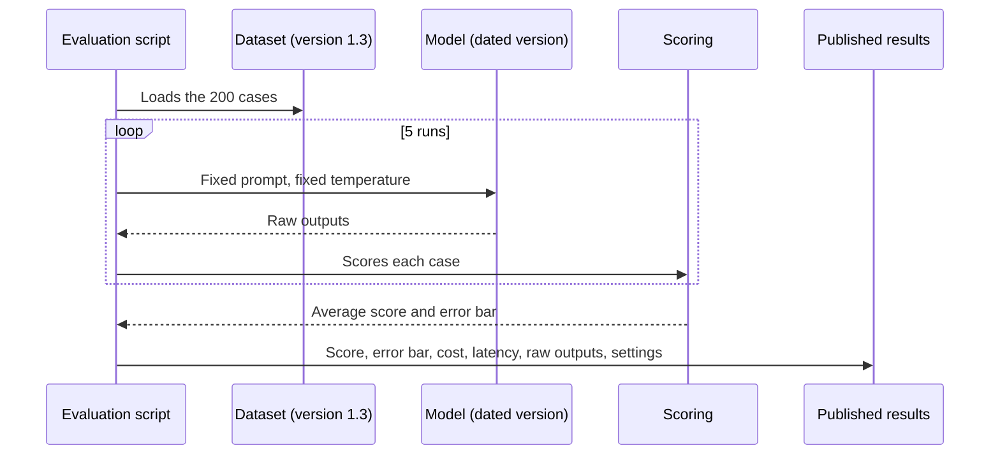

## Reproducibility {#reproductibilite}

A number nobody can redo is a **claim**. A number anyone can redo is a **measurement**.

:::pourquoi
In April 2025, Meta announces Llama 4 Maverick.
An “experimental” variant, tuned for conversation, is 2nd on LMArena.
The public version, tested afterwards, comes 32nd.
The number described a model nobody could download.
:::

What skews a number:

| Trap | Example | Fix |
|---|---|---|
| Vague version | One variant tested, another released | Exact, dated version |
| Best draw | 27 private variants, a single one published | Say how many tries |
| Flawed test | Badly specified tasks, overly strict tests | Review the test set |
| Single run | 74%, with no error bar | Several runs, an error bar |
| Contamination | The model has seen the answers | A private or recent set |
| Different conditions | Two evaluation codes | Same conditions for everyone |

:::pourquoi
The study “The Leaderboard Illusion” (2025) counts 27 private variants tested by Meta before Llama 4.
Keeping the best of 27 is keeping the best draw.
OpenAI created SWE-bench Verified in 2024: 93 developers reviewed 1,699 tasks to keep 500 clear, solvable ones.
:::

The pipeline of a reproducible benchmark:



:::pourquoi
Each element is fixed and versioned.
The five runs give the error bar.
Everything that comes out is published: someone else can rerun the pipeline.
:::

The card to publish with each result:

```yaml
model: claude-sonnet-x-2026-05-01   # dated version, not an alias
dataset: support-golden v1.3 (200 cases)
prompts: prompts/agent-v12.md
temperature: 0
max_tokens: 4096
runs: 5
eval_code: eval/run.py @ commit 3f2a91c
score: 74% ± 3%
cost_per_task: $0.18
latency_p95: 11 s
raw_outputs: results/2026-11-19/
date: 2026-11-19
```

:::pourquoi
Each line changes the result if it changes.
A different prompt can move the score by several points.
Cost and latency avoid praising an agent that is too expensive.
:::

A comparison is only honest under the **same conditions**.

:::pourquoi
One evaluation code can be more generous than another.
Two numbers measured differently can't be compared.
:::

## Key points

- Exact model version, prompts, settings, dataset, code: everything is published.
- Several runs, an error bar, the number of tries before the number.
- Cost, latency and raw outputs alongside the score.
- Same conditions to compare. Watch out for contamination.
