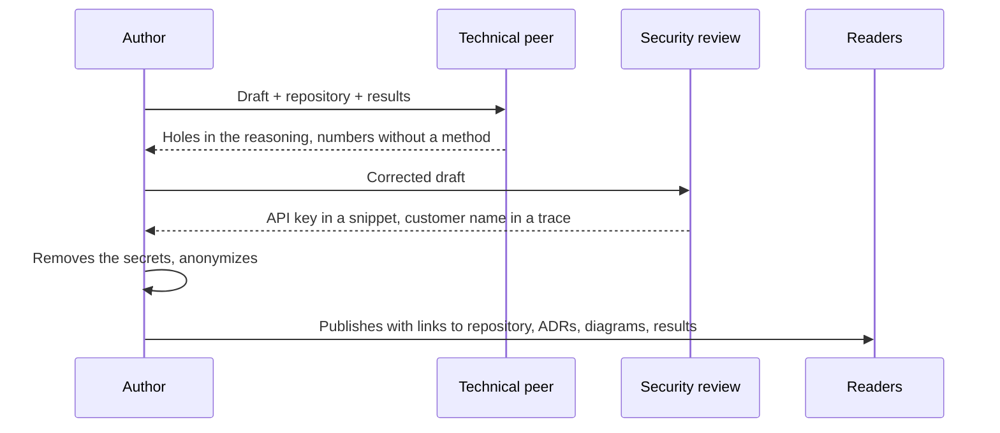

## Analyzing your own architecture {#analyse-architecture}

The code shows **what** was done. The analysis shows **why**, and **at what price**.

:::pourquoi
A recruiter or a peer wants to see your judgment.
Judgment shows in the choices and trade-offs, not in the list of tools.
:::

The outline:

| Section | Content |
|---|---|
| Problem and constraints | What had to be solved, with what budget, what latency, what data |
| Architecture | Data flow and agent topology |
| Decisions | The key choices, the rejected options, links to the ADRs |
| Measurements | Quality, cost, latency, with the method |
| Failures | What didn't work, and why |
| What I would change | With the reasons |

:::pourquoi
The constraints explain the choices.
The rejected options prove there was a choice.
The failures and the “I would change” show perspective.
:::

Give the **price** with the **gain**.

:::pourquoi
Anthropic reports +90.2% for its multi-agent system.
It also writes: about 15 times more tokens, and tasks it suits poorly.
That is what makes the post credible.
:::

Tell the **failures**.

:::pourquoi
Cognition builds its post on a failed Flappy Bird.
OpenAI publishes what it missed with GPT-4o.
A post with no failure casts doubt on the tests.
:::

Every number comes with its **method**: test set, number of cases, runs, error bar, model version.

:::pourquoi
“92%” over 20 cases and one run isn't worth “92%” over 2,000 cases and five runs.
The reader must be able to judge.
:::

Before publishing, two reviews:

:::pourquoi
A peer sees what the author no longer sees.
A published key gets stolen in minutes.
What is published can never be fully taken back.
:::

You remove: **API keys**, **customer data**, **sensitive internal names**, **prompts** that reveal secrets.

:::pourquoi
An agent trace can hold personal data.
You publish the reasoning, not the secrets.
:::

A **title** that announces a decision and its trade-off.

| Weaker | Better |
|---|---|
| “My awesome AI project” | “One agent instead of three: 2.8 times cheaper” |
| “Using LangChain and Pinecone” | “Why our semantic cache returned the wrong answer” |

:::pourquoi
The title tells the reader what they will learn.
A list of tools says nothing about the reasoning.
:::

The whole chapter comes together here: the post **summarizes**, the repository **proves**.

:::pourquoi
The ADRs give the decisions.
The diagrams give the structure.
The evaluation results let others redo the measurement.
:::

## Key points

- Problem, architecture, decisions, measurements, failures, what I would change.
- The price with the gain. The failures with the successes.
- Every number with its method.
- Technical and security review. Links to the repository, the ADRs, the results.
