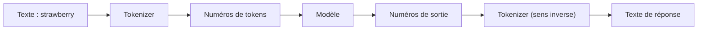
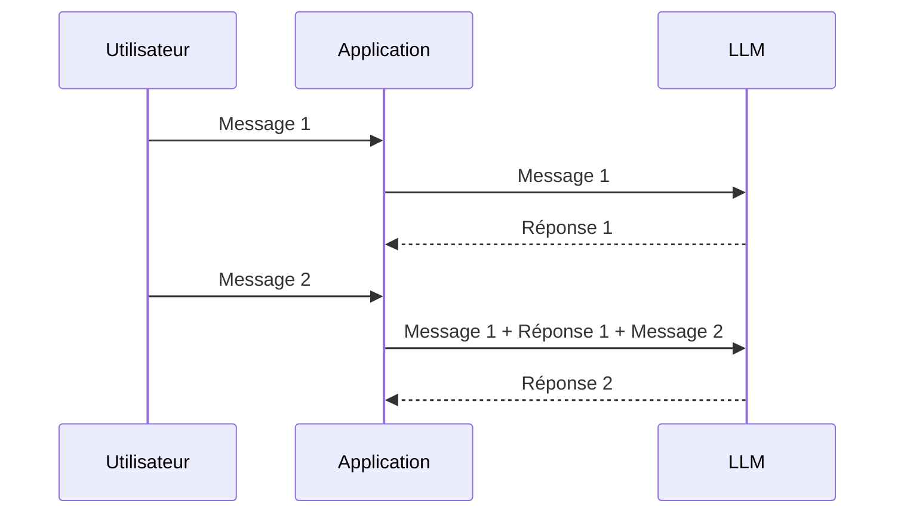

## Ce qu'est un token {#tokens}

Un modèle ne lit pas de lettres. Il lit des tokens.

Un token est un morceau de texte fréquent. Un mot, un bout de mot, un espace suivi d'un mot.

:::pourquoi
Travailler lettre par lettre ferait des séquences très longues.
Travailler mot par mot exigerait un vocabulaire infini.
Le token est le compromis : un vocabulaire fixe, des séquences courtes.
:::

Le **tokenizer** fait le découpage. Il transforme chaque morceau en numéro.

Le modèle ne voit jamais le texte. Seulement les numéros.

:::pourquoi
C'est pour ça qu'il rate « combien de r dans strawberry ».
L'information « lettre » a été effacée avant lui.
Pour compter des lettres, il faut un outil qui voit les lettres.
:::

Ordre de grandeur : en anglais, 1 token ≈ 4 caractères ≈ ¾ de mot.

Le français coûte plus de tokens que l'anglais pour le même sens.

:::pourquoi
Le vocabulaire est appris sur un corpus surtout anglais.
Les mots anglais fréquents y ont leur propre token.
Les mots français sont plus souvent coupés.
:::

Le vocabulaire peut contenir des tokens presque jamais vus à l'entraînement. En 2023, des chercheurs en trouvent dans GPT-3 : « SolidGoldMagikarp » en est le plus célèbre. Ces tokens le font dérailler.

:::pourquoi
Le vocabulaire et le modèle n'ont pas appris sur les mêmes données.
Un token présent dans l'un mais absent de l'autre n'a pas de sens appris.
:::

## La fenêtre de contexte {#fenetre}

La fenêtre de contexte, c'est tout ce que le modèle voit en une fois.

Elle se compte en tokens.

Elle contient **le prompt et la réponse**.

:::pourquoi
Le modèle écrit un token, l'ajoute au contexte, puis écrit le suivant.
La réponse grandit donc dans la même fenêtre que la question.
:::

Le modèle n'a pas de mémoire entre deux appels.

:::pourquoi
Chaque appel est indépendant.
C'est l'application qui renvoie l'historique.
La « mémoire » d'un chat est donc un choix d'application, pas une propriété du modèle.
:::

Si le contenu dépasse la fenêtre, l'API renvoie une erreur.

:::pourquoi
L'API ne sait pas ce qui compte pour toi.
Elle refuse au lieu de couper au hasard.
Décider quoi garder est ton travail. C'est l'étape 1.
:::

## Entrée, sortie et coût {#cout}

Les API facturent au million de tokens. L'entrée et la sortie ont deux prix différents.

Un token de sortie coûte plusieurs fois plus cher qu'un token d'entrée.

:::pourquoi
L'entrée est lue d'un seul bloc, en parallèle.
La sortie est écrite un token à la fois.
Chaque token écrit demande un passage complet dans le modèle.
:::

La longueur de la réponse fait la latence.

:::pourquoi
Mêmes raisons : la sortie est séquentielle.
Une réponse deux fois plus longue prend environ deux fois plus de temps.
:::

Une conversation longue coûte de plus en plus cher à chaque tour.

:::pourquoi
L'historique entier est renvoyé à chaque appel.
Il est facturé à chaque fois.
:::

## À retenir

- Le modèle voit des numéros de tokens, pas des lettres.
- La fenêtre contient la question **et** la réponse.
- Le modèle n'a aucune mémoire. L'application la simule.
- La sortie coûte plus cher et fait la latence.
