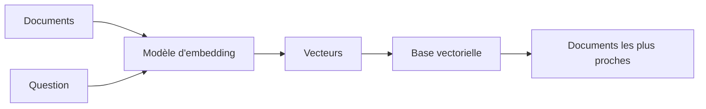

## Un texte devient un vecteur {#vecteur}

Un **modèle d'embedding** transforme un texte en liste de nombres.

Cette liste a toujours la même taille, quel que soit le texte.

On l'appelle un **vecteur**. C'est une position dans un espace du sens.

:::pourquoi
Un ordinateur compare mal des phrases.
Il compare très bien des nombres.
Le vecteur rend le sens calculable.
:::

Deux textes de sens proche ont des vecteurs proches.

:::pourquoi
Question et documents passent par **le même** modèle.
Chaque modèle a son propre espace. Deux espaces ne se comparent pas.
Changer de modèle oblige à tout recalculer.
:::

## La similarité cosinus {#cosinus}

Pour comparer deux vecteurs, on mesure l'angle entre eux.

Même direction : 1. Sans rapport : proche de 0.

:::pourquoi
La direction porte le sens.
La longueur dépend d'autres choses, comme la longueur du texte.
Le cosinus ignore la longueur.
:::

Si les vecteurs sont normalisés, le cosinus est un simple produit scalaire.

:::pourquoi
Moins de calcul, même résultat.
Sur des millions de documents, ça compte.
:::

Un score n'a pas de sens absolu.

:::pourquoi
Chaque modèle a son échelle.
Un seuil se calibre sur tes propres exemples.
:::

## Ce qu'un embedding capte, et ce qu'il rate {#limites}

Il capte bien le **thème**. Il rate souvent la **précision**.

Il capte mal :

- la négation : « j'aime » et « je n'aime pas » sont voisins ;
- les identifiants : numéros de facture, références, codes ;
- les noms rares et les chiffres exacts.

:::pourquoi
L'embedding résume un texte en une seule position.
Ce qui change peu le sujet change peu la position.
Une négation ou un chiffre changent peu le sujet.
:::

Pour ces cas, on combine avec une recherche par mots-clés. C'est l'étape 2.

Le célèbre « roi − homme + femme ≈ reine » de 2013 a une petite astuce. Le code exclut les mots de départ des réponses possibles.

:::pourquoi
Sans ce filtre, la réponse est souvent l'un des mots de départ.
Les embeddings ont une vraie structure. Mais les démos l'embellissent.
:::

## À retenir

- Un embedding est une position dans l'espace du sens.
- Même modèle pour la question et les documents.
- Le cosinus compare des directions. Les seuils se calibrent.
- Bon sur le thème, faible sur la négation et les identifiants.
