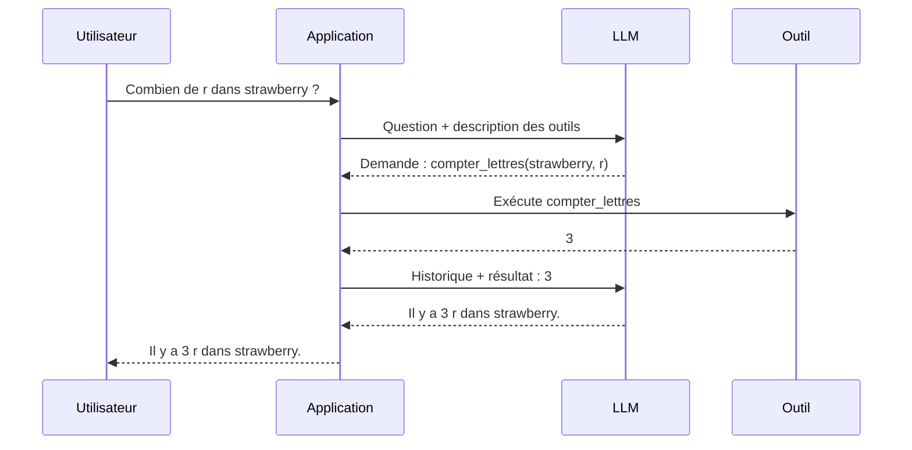

## Décrire un outil {#decrire}

Le modèle ne fait que du texte. Il ne peut ni lire un fichier, ni appeler une API.

Un **outil** lui permet de demander ces actions à ton application.

:::pourquoi
C'est la réponse au bug de « strawberry ».
Le modèle ne voit pas les lettres. Un outil, si.
Le modèle sait quand demander. L'outil sait faire.
:::

Un outil se décrit avec trois choses :

- un **nom** : `compter_lettres` ;
- une **description** : quand l'utiliser, et quand ne pas l'utiliser ;
- un **schéma JSON** des paramètres : `mot` (texte), `lettre` (un caractère).

:::pourquoi
Le modèle ne voit jamais ton code.
Il choisit l'outil uniquement d'après la description.
Une description floue donne de mauvais choix.
:::

## La boucle appel, résultat, réponse {#boucle}

Quatre acteurs interagissent.

1. L'application envoie la question **et** la liste des outils.
2. Le modèle répond par une **demande d'outil**, pas par du texte.
3. L'application exécute l'outil.
4. Elle renvoie le résultat au modèle, avec tout l'historique.
5. Le modèle répond, ou demande un autre outil.

:::pourquoi
Le modèle n'a pas de mémoire entre deux appels.
L'application doit donc renvoyer la question, la demande et le résultat.
Sinon le modèle ne sait plus pourquoi il a demandé cet outil.
:::

La boucle s'arrête quand le modèle répond sans demander d'outil.

Fixe aussi un nombre maximum de tours.

:::pourquoi
Un modèle peut rappeler le même outil en boucle.
Chaque tour coûte des tokens.
La limite protège ton budget.
:::

## Ce qui peut mal tourner {#risques}

**Arguments faux.** Le modèle peut inventer une valeur. Valide toujours avant d'exécuter.

:::pourquoi
Le schéma vérifie le format, pas la vérité.
Un identifiant inventé a le bon format.
:::

**Résultat piégé.** Un outil peut renvoyer du texte écrit par n'importe qui.

:::pourquoi
Une page web peut contenir « ignore tes instructions ».
Ce texte est une donnée. Jamais une instruction.
C'est l'étape 6.
:::

**Outil en échec.** Renvoie une erreur claire au modèle.

:::pourquoi
Un résultat vide ressemble à « aucune donnée ».
Une erreur claire lui permet de réessayer ou de prévenir.
:::

## À retenir

- Le modèle demande. L'application exécute.
- La description de l'outil est tout ce que le modèle voit.
- La boucle tourne jusqu'à une réponse finale, avec une limite.
- Arguments à valider, résultats à traiter comme des données.
