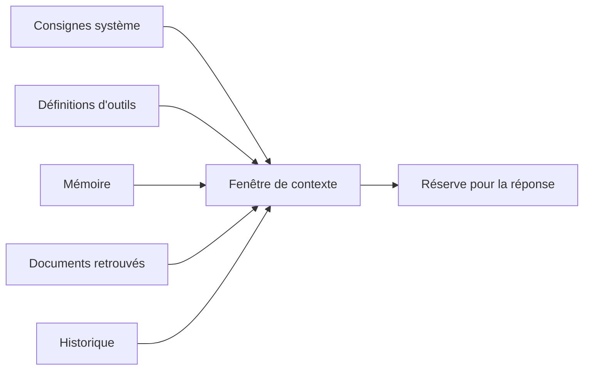

## Répartir la fenêtre {#repartir}

La fenêtre est partagée entre plusieurs occupants.

Chaque occupant a une part. Ensemble, ils ne doivent pas dépasser la fenêtre.

:::pourquoi
Sans budget, le plus gros gagne.
Un seul résultat d'outil énorme peut chasser tout l'historique.
Un budget par occupant garde l'équilibre.
:::

Plus de contexte ne veut pas dire mieux.

:::pourquoi
En 2025, Chroma teste 18 modèles.
Plus l'entrée s'allonge, moins les réponses sont fiables. Même sur des tâches simples.
Les passages proches mais faux, les distracteurs, aggravent l'effet.
:::

La position compte aussi. Le milieu est la zone la moins bien lue.

:::pourquoi
L'étude Lost in the Middle (2023) trace une courbe en U.
Le début et la fin sont bien utilisés. Le milieu, moins.
:::

Les outils prennent de la place. Leurs définitions sont renvoyées à chaque appel.

:::pourquoi
Le modèle n'a pas de mémoire.
Tout ce qu'il doit savoir, il le reçoit à chaque fois.
:::

Mesure en tokens, avec le tokenizer du modèle. Pas en caractères.

:::pourquoi
La règle « 4 caractères = 1 token » vaut pour l'anglais courant.
Le code, le JSON et le français s'en écartent.
:::

## Réserver la sortie {#sortie}

La réponse vit dans la même fenêtre que le prompt.

Réserve sa place **avant** de remplir le reste.

:::pourquoi
Si l'entrée prend tout, la réponse est coupée ou refusée.
Une réponse coupée ressemble à une réponse normale.
:::

La formule : entrée + sortie maximale ≤ fenêtre.

Les modèles qui réfléchissent ont besoin d'une réserve plus grande.

:::pourquoi
Leur raisonnement est du texte généré.
Il compte comme sortie, avant la réponse visible.
:::

C'est ton application qui fait ce calcul.

:::pourquoi
Elle seule connaît la taille de l'entrée et la longueur attendue.
:::

## À retenir

- La fenêtre est un plafond, pas un objectif.
- Plus d'entrée, plus de distracteurs : moins de fiabilité.
- Le milieu est la zone la moins bien lue.
- Réserve d'abord la sortie. Compte avec le tokenizer du modèle.
