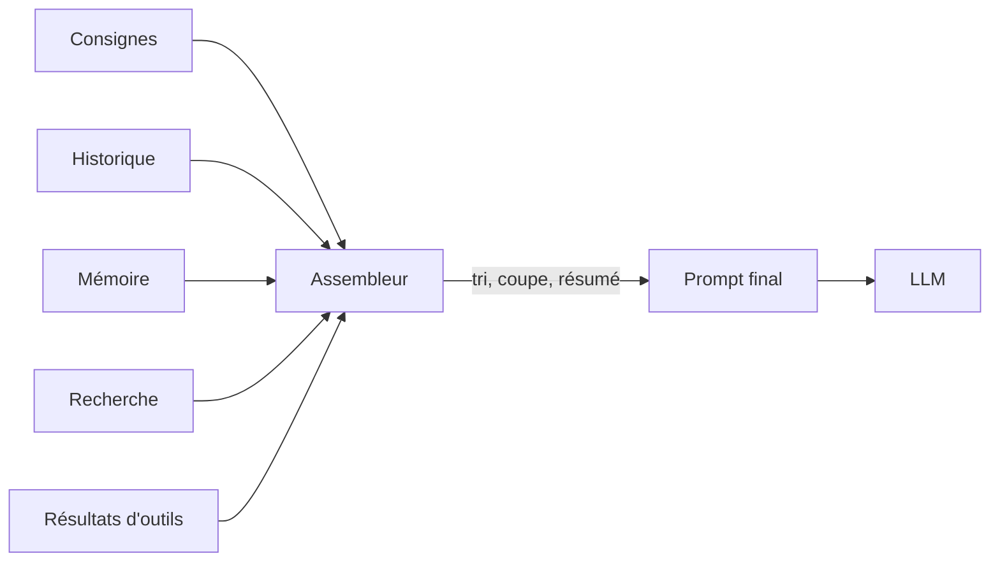

## Que couper d'abord {#couper}

Le contexte est trop grand. Il faut choisir.

On classe chaque morceau par priorité.

| Priorité | Morceau | Pourquoi |
|---|---|---|
| Jamais coupé | Consignes système, question actuelle | Sans eux, plus de tâche |
| Haute | Derniers tours, résultats d'outils récents | La tâche en cours en dépend |
| Moyenne | Documents pertinents, mémoire utile | Ils aident, mais se trient |
| Basse | Vieux tours, résultats d'outils déjà exploités | Ils ont déjà servi |

:::pourquoi
Un morceau vaut ce qu'il apporte à la prochaine réponse.
Un vieux résultat d'outil est souvent gros et déjà résumé par le modèle lui-même.
:::

Plusieurs sources alimentent le contexte. Un **assembleur** les trie.

:::pourquoi
Chaque source ignore les autres.
L'assembleur est le seul à voir le budget total.
C'est lui qui arbitre.
:::

L'ordre compte : longs documents en haut, question à la fin.

:::pourquoi
La fin est bien lue. La question reste fraîche au moment de répondre.
L'aiguille dans la botte de foin a montré que la présentation change le résultat.
:::

## Troncature et résumé {#resume}

Deux façons de réduire.

**Troncature** : on coupe. Gratuit, prévisible. Ce qui est coupé est perdu.

**Résumé** : on demande au modèle de condenser. Ça coûte un appel. Les détails exacts partent.

:::pourquoi
Un résumé garde le sens, pas les chiffres.
« Commande 48213, 312,50 € » devient « une commande ».
Garde mot pour mot les identifiants, montants et dates encore utiles.
:::

On combine souvent les deux : résumé des vieux tours, troncature des gros résultats.

Coupe par tours entiers. Jamais une demande d'outil sans son résultat.

:::pourquoi
Les API vérifient que chaque résultat répond à une demande.
Une paire cassée rend l'historique invalide.
:::

## Prévenir le débordement {#debordement}

Compte **avant** d'envoyer. Pas après l'erreur.

Fixe un seuil, par exemple 80 % du budget. Au-delà, on compacte.

:::pourquoi
L'erreur arrive devant l'utilisateur.
Le seuil laisse le temps de résumer proprement.
:::

Limite la taille de chaque résultat d'outil. Indique qu'il est tronqué. Donne un moyen de lire la suite.

:::pourquoi
Un seul résultat énorme peut tout chasser.
Le modèle sait demander une page de plus si on lui dit que c'est possible.
:::

En février 2023, Microsoft limite Bing Chat à 5 tours par session.

:::pourquoi
Selon Microsoft, les très longues sessions pouvaient embrouiller le modèle.
Couper la session est la prévention la plus simple.
Mais c'est l'utilisateur qui en paie le prix.
Un bon assembleur fait mieux : il compacte sans tout effacer.
:::

## À retenir

- Jamais coupé : consignes et question actuelle.
- Coupé d'abord : vieux tours et résultats d'outils déjà exploités.
- Résumé pour le sens, mot pour mot pour les détails exacts.
- Compte avant d'envoyer. Compacte à un seuil.
