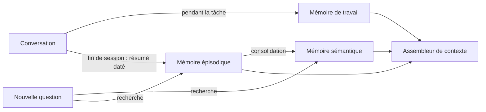

## Trois mémoires

Le modèle n'a aucune mémoire. On lui en construit une.

On reprend une distinction de la psychologie : travail, épisodes, faits.

| Mémoire | Contient | Exemple | Durée |
|---|---|---|---|
| Travail | L'état de la tâche en cours | « Étape 3 sur 5 : tests à relancer » | La tâche |
| Épisodique | Ce qui s'est passé | « Le 3 mars, commande annulée » | Semaines, mois |
| Sémantique | Ce qu'on sait | « Végétarien » | Longtemps, révisable |

:::pourquoi
Chaque mémoire répond à une question différente.
Où j'en suis ? Que s'est-il passé ? Qu'est-ce que je sais ?
Les mélanger donne un tas que personne ne sait trier.
:::

Les trois s'alimentent et se rappellent.

## Mémoire de travail {#travail}

C'est le bloc-notes de la tâche en cours : plan, étapes faites, décisions.

Elle vit le temps de la tâche.

:::pourquoi
L'historique finit par être coupé ou résumé.
Le plan risque de disparaître avec lui.
Un bloc-notes court garde l'état, quoi qu'il arrive à l'historique.
:::

## Mémoire épisodique {#episodique}

Elle garde les événements. Datés, compressés.

« 3 mars : l'utilisateur annule la commande 48213. Raison : délai trop long. »

:::pourquoi
Une conversation brute fait des milliers de tokens.
Un épisode compressé en fait quelques dizaines.
On peut en rappeler beaucoup plus.
:::

## Mémoire sémantique {#semantique}

Elle garde les faits durables. Sans date.

« Végétarien. » « Préfère les réponses courtes. » « Travaille en Rust. »

Ces faits viennent des épisodes. C'est la **consolidation**.

:::pourquoi
Un fait tiré de dix épisodes est solide.
Un fait tiré d'un seul est une hypothèse.
Garde le lien vers les épisodes qui le justifient.
:::

On n'injecte pas tous les faits. On cherche ceux qui servent la question.

:::pourquoi
Tout injecter coûte cher et noie le modèle.
Rappeler un souvenir, c'est une recherche, comme pour un document.
:::

En 2023, MemGPT pousse l'idée plus loin. Le contexte est la RAM. Le stockage est le disque. Le modèle range et rappelle lui-même, avec des outils.

:::pourquoi
Un système d'exploitation déplace déjà les données entre RAM et disque.
MemGPT donne ce rôle au modèle.
Il décide ce qui doit rester sous ses yeux.
:::

## À retenir

- Travail : où j'en suis. Épisodique : ce qui s'est passé. Sémantique : ce que je sais.
- Les épisodes se compressent. Les faits se consolident.
- Un fait doit garder ses sources.
- Rappeler, c'est chercher. On n'injecte que le pertinent.
