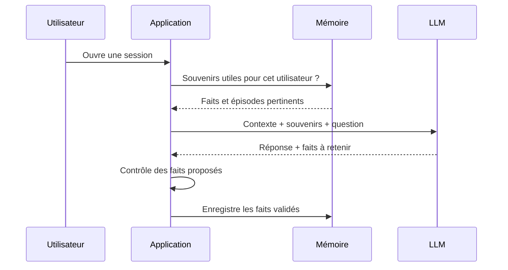

## Score d'importance {#importance}

Tout ne mérite pas d'être retenu.

En 2023, Stanford crée *Generative Agents* : 25 personnages simulés dans un petit village. Chacun a une mémoire.

Chaque souvenir reçoit une note d'importance, de 1 à 10. C'est le modèle qui note.

:::pourquoi
Une règle fixe ne sait pas qu'une rupture compte plus qu'un café.
Le modèle, lui, comprend le sens.
Une note au moment de l'enregistrement, et c'est réglé une fois pour toutes.
:::

Pour rappeler un souvenir, ils combinent trois scores.

| Score | Question | Calcul |
|---|---|---|
| Récence | Utilisé récemment ? | Décroît de 0,5 % par heure de jeu |
| Importance | Marquant ? | Note du modèle, de 1 à 10 |
| Pertinence | Lié à la situation ? | Similarité d'embeddings |

:::pourquoi
La pertinence seule ressortirait un café de lundi dernier.
La récence seule oublierait les grands événements.
Les trois ensemble imitent assez bien la mémoire humaine.
:::

## TTL et éviction {#ttl}

Une mémoire qui ne fait que grossir devient un problème.

Elle coûte. Elle ralentit la recherche. Elle garde des faits devenus faux.

Le **TTL** donne une durée de vie à chaque souvenir.

| Mémoire | TTL typique |
|---|---|
| Travail | Fin de la tâche |
| Épisodique | Semaines ou mois |
| Sémantique | Long, mais révisable |

:::pourquoi
Un plan de tâche n'a plus de valeur une fois la tâche finie.
Un épisode perd de la valeur avec le temps.
Un fait reste vrai tant qu'il n'est pas contredit.
:::

Un fait contredit est **remplacé**. Pas dupliqué.

:::pourquoi
« Habite Lyon » et « habite Genève » côte à côte : le modèle peut choisir le mauvais.
On met à jour le fait. L'épisode du déménagement garde l'historique.
:::

Quand la place manque, on **évince** les souvenirs au score combiné le plus bas.

## Persistance entre sessions {#persistance}

Une mémoire persistante survit à la fin de la session.

Elle est stockée hors du modèle : base de données, fichiers.

:::pourquoi
Le modèle propose. L'application décide de ce qui entre en mémoire.
Un souvenir faux revient à chaque session.
:::

En septembre 2024, Johann Rehberger montre l'attaque *SpAIware* contre ChatGPT. Une page piégée fait enregistrer une instruction en mémoire. Elle revient dans toutes les conversations suivantes.

:::pourquoi
La mémoire rend une attaque permanente.
Ce qui vient d'une page, d'un mail ou d'un outil est une donnée.
Ça n'entre pas en mémoire sans contrôle.
:::

Une mémoire par utilisateur. Toujours isolée.

:::pourquoi
Un souvenir qui fuit chez un autre est une fuite de données personnelles.
Chaque recherche filtre par propriétaire.
:::

L'effacement doit être possible, partout.

:::pourquoi
Le RGPD donne un droit à l'effacement.
Des souvenirs sur une personne sont des données personnelles.
:::

## À retenir

- Rappeler selon trois critères : récence, importance, pertinence.
- Chaque mémoire a sa durée de vie. Un fait contredit est remplacé.
- Le modèle propose les souvenirs. L'application les contrôle.
- Mémoire isolée par utilisateur, et effaçable.
