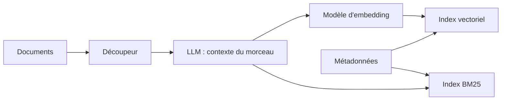

## Découpage {#decoupage}

On ne cherche pas dans des documents. On cherche dans des **morceaux** (*chunks*).

:::pourquoi
Un vecteur pour un long document fait la moyenne de ses sujets.
Il ne ressemble plus à aucune question précise.
Un morceau porte une idée. Il se retrouve et s'injecte.
:::

La taille est un compromis.

| Trop petit | Trop grand |
|---|---|
| Perd son contexte | Mélange plusieurs idées |
| « Il a progressé de 3 % » : qui ? | Gaspille le budget de tokens |

Coupe aux frontières naturelles : titres, paragraphes, fonctions. Ne coupe jamais un tableau.

:::pourquoi
L'auteur a déjà structuré son texte par idées.
Un tableau sans ses en-têtes n'a plus de sens.
:::

Ajoute un **chevauchement** : quelques phrases répétées d'un morceau au suivant.

:::pourquoi
Une coupure peut tomber au milieu d'une explication.
Le chevauchement garde l'idée entière dans au moins un morceau.
:::

En 2024, Anthropic publie **Contextual Retrieval**. Un LLM écrit 50 à 100 tokens de contexte pour chaque morceau. On les colle devant avant d'indexer.

| Méthode | Échecs dans les 20 premiers |
|---|---|
| Base | 5,7 % |
| + contexte, embeddings | 3,7 % |
| + contexte, embeddings et BM25 | 2,9 % |
| + reranking | 1,9 % |

:::pourquoi
« Le chiffre d'affaires a progressé de 3 % » devient « ACME, T2 2023 : le chiffre d'affaires a progressé de 3 % ».
Le morceau redevient trouvable.
Ce sont les chiffres d'Anthropic, sur ses propres données. Chez toi, ils seront différents.
:::

## Métadonnées {#metadonnees}

Chaque morceau porte une fiche : source, date, auteur, type, langue, version, droits d'accès.

:::pourquoi
Le texte ne dit pas tout.
Une blague et un conseil se ressemblent. Seule la source les distingue.
C'est ce que Google a dû ajouter après la colle sur la pizza.
:::

Les droits d'accès se filtrent **pendant** la recherche.

:::pourquoi
Un document retrouvé est lu par le modèle.
Une consigne « ne le révèle pas » peut être contournée.
Le seul filtre sûr : il n'est jamais retrouvé.
:::

Filtre avant ou pendant la recherche. Pas après.

:::pourquoi
Les 10 meilleurs résultats peuvent tous être éliminés par le filtre.
Il ne reste alors rien, alors que de bons documents existaient.
:::

## Indexation {#indexation}

Chaque morceau va dans deux index.

L'index vectoriel utilise une recherche **approximative**, souvent HNSW.

:::pourquoi
Comparer la question à des millions de vecteurs un par un est trop lent.
HNSW saute de voisin en voisin vers la bonne zone.
Il rate parfois un voisin. C'est le prix de la vitesse.
:::

Stocke avec chaque morceau : son texte, l'identifiant du document, sa position, ses métadonnées.

:::pourquoi
Texte pour l'injecter. Identifiant pour citer et mettre à jour.
Position pour lire les voisins. Métadonnées pour filtrer.
:::

Un document change : remplace **tous** ses morceaux.

:::pourquoi
Un ancien morceau oublié reste trouvable.
Le modèle citera un tarif périmé, en toute confiance.
:::

## À retenir

- Des morceaux qui portent une idée, coupés sur la structure.
- Un morceau sans contexte devient introuvable. Ajoute-le.
- Les métadonnées filtrent ce que le texte ne dit pas, dont les droits d'accès.
- Mise à jour : on remplace tous les morceaux du document.
