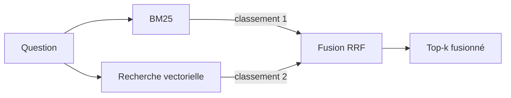

## BM25 {#bm25}

BM25 cherche par **mots**. C'est l'héritier des moteurs de recherche des années 1990.

Il favorise trois choses :

- les mots **rares** du corpus (ils distinguent) ;
- les mots **présents** dans le document, avec un effet qui sature ;
- les documents **courts** à score égal.

:::pourquoi
Un mot présent partout ne distingue rien.
Répéter un mot 50 fois ne rend pas 50 fois plus pertinent.
Un long document contient beaucoup de mots par hasard.
:::

Fort sur : identifiants, codes, noms propres, termes techniques.

Faible sur : synonymes, reformulations, autres langues.

:::pourquoi
BM25 compare des mots, pas des idées.
« résilier » et « mettre fin » n'ont aucun mot commun.
:::

En français, configure un analyseur de langue.

:::pourquoi
Sans lui, « chevaux » et « cheval » sont deux mots sans rapport.
L'analyseur ramène les mots à leur racine et gère les accents.
:::

## Recherche vectorielle {#vectorielle}

On encode la question. On cherche les morceaux dont le vecteur est le plus proche.

Fort sur : synonymes, reformulations, multilingue.

Faible sur : identifiants, négation, domaines inconnus du modèle.

:::pourquoi
L'embedding capte le sens général.
Un numéro de facture n'a pas de « sens ».
Un modèle entraîné sur du web généraliste connaît mal ton jargon métier.
:::

En 2021, le benchmark BEIR teste des modèles sur 18 jeux de données. BM25 reste une base solide. Plusieurs modèles vectoriels font moins bien hors de leur domaine.

:::pourquoi
Un modèle appris sur un domaine perd pied sur un autre.
BM25 n'a rien appris, donc rien à oublier.
Mesure sur tes données avant de choisir.
:::

Respecte les consignes du modèle : certains veulent un préfixe pour la question et un autre pour le document.

:::pourquoi
Une question courte ne ressemble pas à un passage long.
Le préfixe dit au modèle quel rôle joue chaque texte.
L'oublier dégrade les résultats en silence.
:::

## Fusion hybride (RRF) {#hybride}

On lance les deux recherches. On fusionne leurs classements.

:::pourquoi
Leurs échecs sont différents.
Ce que l'un rate, l'autre le trouve souvent.
:::

On fusionne les **rangs**, pas les scores.

:::pourquoi
Un score BM25 n'a pas d'échelle fixe. Un cosinus reste entre -1 et 1.
Les additionner donnerait tout le pouvoir à BM25.
:::

**RRF** (Reciprocal Rank Fusion, 2009) : chaque document gagne 1/(k + rang) dans chaque liste. On additionne. k vaut souvent 60.

| Document | Rang BM25 | Rang vectoriel | Score RRF |
|---|---|---|---|
| A | 1 | absent | 1/61 ≈ 0,0164 |
| B | 2 | 2 | 2 × 1/62 ≈ 0,0323 |

:::pourquoi
Un document bien classé par les deux recherches est un pari sûr.
RRF récompense cet accord.
k = 60 amortit l'écart entre le 1er et le 2e rang.
:::

## À retenir

- BM25 : mots exacts, identifiants. Rate les synonymes.
- Vectoriel : sens, synonymes. Rate les identifiants et les domaines inconnus.
- Hybride : on fusionne les rangs avec RRF.
- Mesure sur tes données avant d'écarter BM25.
